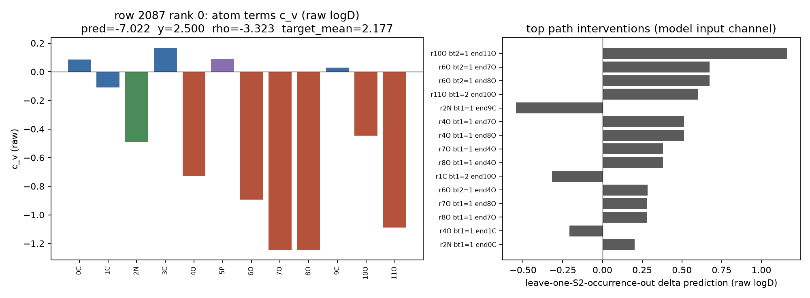
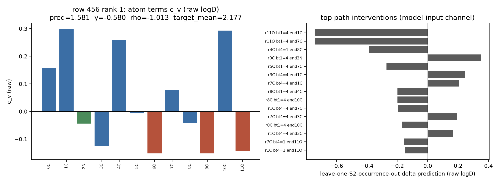
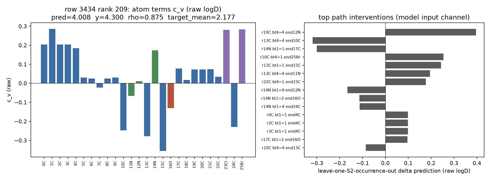
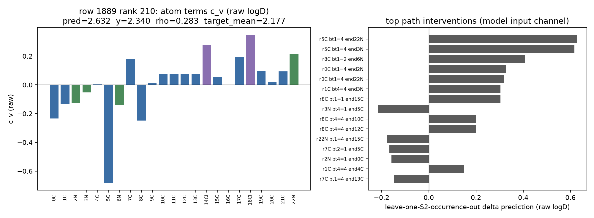
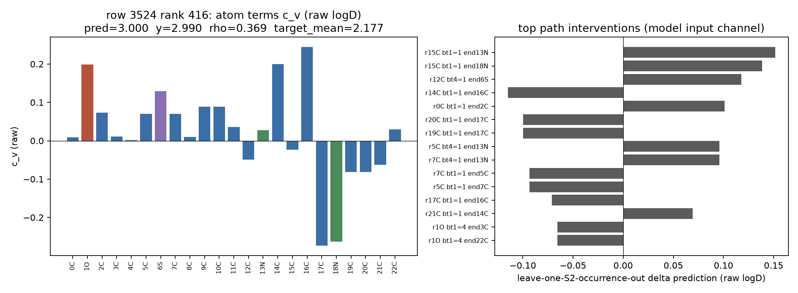
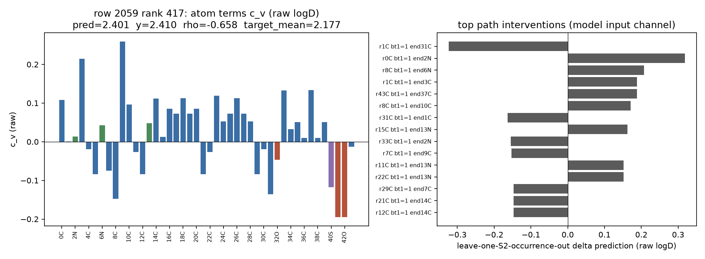
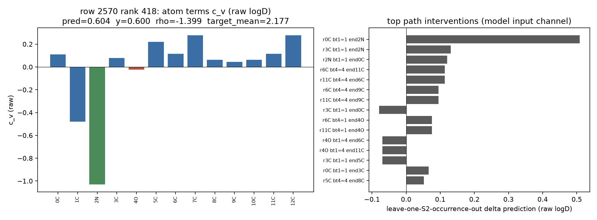
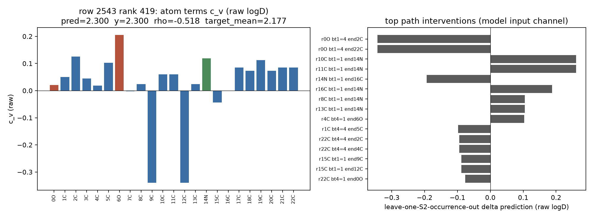

# 回溯表（模型内部预测回溯，非化学因果）

## A. 固定权重干预（122 Valid 前 64 行）

| 干预 | mean abs Δpred | max abs Δpred | ΔRMSE (per seed) | 覆盖行比例 |
|---|---|---|---|---|
| `g_zero` | 0.4736 | 2.7182 | +0.4261 [0.43532, 0.331302, 0.511733] | 1.000 |
| `contrib_zero` | 0.6620 | 2.0047 | +0.5141 [0.493548, 0.506336, 0.542288] | 1.000 |
| `mean_h2_zero` | 0.3353 | 1.4067 | +0.2399 [0.249046, 0.28713, 0.183615] | 1.000 |
| `typed_s2_zero` | 1.6774 | 7.8734 | +1.7272 [1.270964, 1.574233, 2.336415] | 1.000 |
| `agg_b5` | 0.1316 | 0.6467 | +0.0443 [0.030643, 0.04955, 0.052594] | 0.984 |

每个 seed 的 baseline：contrib 与 rho 的均值/标准差/相关系数（原始单位，前 64 行）。

| seed | contrib mean | contrib sd | rho mean | rho sd | corr(contrib, rho) |
|---|---|---|---|---|---|
| 0 | +0.1748 | 0.8053 | -0.2606 | 0.8115 | +0.0358 |
| 1 | +0.2277 | 0.7722 | -0.3525 | 0.6146 | +0.1582 |
| 2 | +0.2649 | 0.8272 | -0.2953 | 0.6803 | +0.1235 |

干预前后的输入/激活范数（seed 平均；L2 per row）：

| 干预 | ‖g‖ before→after | ‖L‖ | ‖mean_h2‖ | ‖path_agg‖ | ‖content_agg‖ |
|---|---|---|---|---|---|
| `g_zero` | 5.847→0.000 | 0.662→0.662 | 10.426→10.426 | 22.608→22.608 | 2.891→2.891 |
| `contrib_zero` | 5.847→5.847 | 0.662→0.000 | 10.426→10.426 | 22.608→22.608 | 2.891→2.891 |
| `mean_h2_zero` | 5.847→5.847 | 0.662→0.662 | 10.426→0.000 | 22.608→22.608 | 2.891→2.891 |
| `typed_s2_zero` | 5.847→5.847 | 0.662→1.809 | 10.426→9.945 | 22.608→0.000 | 2.891→0.000 |
| `agg_b5` | 5.847→5.847 | 0.662→0.681 | 10.426→10.421 | 22.608→22.535 | 2.891→2.893 |

## B. Leave-one-S2-occurrence-out（FULL seed0）

### rank 0 · row 2087 · y=2.500 pred=-7.022

`CC(N)(COP(=O)(O)O)C(=O)O`

target_mean=2.1770, L=-5.8761, rho=-3.3225, identity residual +2.88e-07

| path | root→mid→end | bt1→bt2 | closure | pred before→after | f_root before→after | ΔL | Δrho | Δpred | max Δ other f | identity gap |
|---|---|---|---|---|---|---|---|---|---|---|
| 31 | 10O→9→11O | 2→1 | 0 | -7.022→-5.862 | -0.446→+0.074 | +0.5203 | +0.6393 | +1.1596 | 0.00e+00 | +2.88e-07 |
| 19 | 6O→5→7O | 2→1 | 0 | -7.022→-6.348 | -0.893→-0.465 | +0.4282 | +0.2457 | +0.6738 | 0.00e+00 | +2.88e-07 |
| 20 | 6O→5→8O | 2→1 | 0 | -7.022→-6.348 | -0.893→-0.465 | +0.4282 | +0.2457 | +0.6738 | 0.00e+00 | +2.88e-07 |
| 33 | 11O→9→10O | 1→2 | 0 | -7.022→-6.419 | -1.088→-0.415 | +0.6726 | -0.0700 | +0.6025 | 0.00e+00 | +4.44e-16 |
| 8 | 2N→1→9C | 1→1 | 0 | -7.022→-7.565 | -0.489→-0.944 | -0.4555 | -0.0877 | -0.5432 | 0.00e+00 | +1.33e-15 |
| 15 | 4O→5→7O | 1→1 | 0 | -7.022→-6.509 | -0.729→-0.221 | +0.5078 | +0.0053 | +0.5131 | 0.00e+00 | +5.77e-07 |
| 16 | 4O→5→8O | 1→1 | 0 | -7.022→-6.509 | -0.729→-0.221 | +0.5078 | +0.0053 | +0.5131 | 0.00e+00 | +5.77e-07 |
| 21 | 7O→5→4O | 1→1 | 0 | -7.022→-6.640 | -1.246→-0.914 | +0.3322 | +0.0497 | +0.3819 | 0.00e+00 | +5.77e-07 |
| 24 | 8O→5→4O | 1→1 | 0 | -7.022→-6.640 | -1.246→-0.914 | +0.3322 | +0.0497 | +0.3819 | 0.00e+00 | +2.88e-07 |
| 4 | 1C→9→10O | 1→2 | 0 | -7.022→-7.339 | -0.108→+0.025 | +0.1332 | -0.4509 | -0.3176 | 0.00e+00 | +8.88e-16 |
| 18 | 6O→5→4O | 2→1 | 0 | -7.022→-6.739 | -0.893→-0.708 | +0.1846 | +0.0984 | +0.2830 | 0.00e+00 | +5.77e-07 |
| 23 | 7O→5→8O | 1→1 | 0 | -7.022→-6.742 | -1.246→-0.981 | +0.2646 | +0.0148 | +0.2794 | 0.00e+00 | +2.88e-07 |

### rank 1 · row 456 · y=-0.580 pred=1.581

`Cc1ncc(CO)c(CO)c1O`

target_mean=2.1770, L=+0.4163, rho=-1.0125, identity residual +2.22e-16

| path | root→mid→end | bt1→bt2 | closure | pred before→after | f_root before→after | ΔL | Δrho | Δpred | max Δ other f | identity gap |
|---|---|---|---|---|---|---|---|---|---|---|
| 30 | 11O→10→1C | 1→4 | 0 | +1.581→+0.837 | -0.144→-0.520 | -0.3757 | -0.3685 | -0.7442 | 0.00e+00 | +0.00e+00 |
| 31 | 11O→10→7C | 1→4 | 0 | +1.581→+0.837 | -0.144→-0.520 | -0.3757 | -0.3685 | -0.7442 | 0.00e+00 | +0.00e+00 |
| 13 | 4C→7→8C | 4→1 | 0 | +1.581→+1.197 | +0.260→-0.164 | -0.4238 | +0.0400 | -0.3839 | 0.00e+00 | -9.01e-09 |
| 0 | 0C→1→2N | 1→4 | 0 | +1.581→+1.931 | +0.156→+0.287 | +0.1316 | +0.2182 | +0.3498 | 0.00e+00 | +0.00e+00 |
| 16 | 5C→4→7C | 1→4 | 0 | +1.581→+1.309 | -0.007→-0.085 | -0.0779 | -0.1940 | -0.2719 | 0.00e+00 | -5.55e-17 |
| 8 | 3C→2→1C | 4→4 | 0 | +1.581→+1.828 | -0.125→-0.027 | +0.0974 | +0.1499 | +0.2473 | 0.00e+00 | +0.00e+00 |
| 21 | 7C→10→1C | 4→4 | 0 | +1.581→+1.785 | +0.078→+0.069 | -0.0094 | +0.2134 | +0.2040 | 0.00e+00 | +1.11e-16 |
| 23 | 8C→7→4C | 1→4 | 0 | +1.581→+1.382 | -0.042→-0.069 | -0.0265 | -0.1727 | -0.1992 | 0.00e+00 | +3.60e-08 |
| 24 | 8C→7→10C | 1→4 | 0 | +1.581→+1.382 | -0.042→-0.069 | -0.0265 | -0.1727 | -0.1992 | 0.00e+00 | +3.60e-08 |
| 3 | 1C→10→7C | 4→4 | 0 | +1.581→+1.383 | +0.297→+0.061 | -0.2365 | +0.0388 | -0.1976 | 0.00e+00 | +1.94e-16 |
| 18 | 7C→4→3C | 4→4 | 0 | +1.581→+1.776 | +0.078→+0.056 | -0.0226 | +0.2182 | +0.1955 | 0.00e+00 | -1.11e-16 |
| 1 | 0C→1→10C | 1→4 | 0 | +1.581→+1.412 | +0.156→+0.034 | -0.1213 | -0.0471 | -0.1685 | 0.00e+00 | +3.60e-08 |

### rank 209 · row 3434 · y=4.300 pred=4.008

`CC(C)(C)c1ccc(cc1)c2n[nH]c(NC(=O)c3ccccc3Cl)c2Br`

target_mean=2.1770, L=+0.9561, rho=+0.8751, identity residual +7.21e-08

| path | root→mid→end | bt1→bt2 | closure | pred before→after | f_root before→after | ΔL | Δrho | Δpred | max Δ other f | identity gap |
|---|---|---|---|---|---|---|---|---|---|---|
| 34 | 10C→11→12N | 4→4 | 0 | +4.008→+4.404 | -0.248→+0.076 | +0.3243 | +0.0714 | +0.3957 | 0.00e+00 | +7.21e-08 |
| 45 | 13C→24→10C | 4→4 | 0 | +4.008→+3.690 | -0.279→-0.594 | -0.3150 | -0.0033 | -0.3183 | 0.00e+00 | +7.21e-08 |
| 50 | 14N→15→17C | 1→1 | 0 | +4.008→+3.708 | +0.173→-0.086 | -0.2598 | -0.0404 | -0.3002 | 0.00e+00 | +1.44e-07 |
| 36 | 10C→24→25Br | 4→1 | 0 | +4.008→+4.261 | -0.248→-0.018 | +0.2299 | +0.0234 | +0.2532 | 0.00e+00 | +7.21e-08 |
| 44 | 13C→14→15C | 1→1 | 0 | +4.008→+4.252 | -0.279→-0.017 | +0.2619 | -0.0184 | +0.2435 | 0.00e+00 | +1.44e-07 |
| 43 | 13C→12→11N | 4→4 | 0 | +4.008→+4.203 | -0.279→-0.087 | +0.1920 | +0.0029 | +0.1949 | 0.00e+00 | +1.44e-07 |
| 71 | 22C→17→15C | 4→1 | 0 | +4.008→+4.185 | +0.034→+0.203 | +0.1692 | +0.0077 | +0.1769 | 0.00e+00 | +3.33e-16 |
| 47 | 14N→13→12N | 1→4 | 0 | +4.008→+3.843 | +0.173→+0.017 | -0.1559 | -0.0096 | -0.1655 | 0.00e+00 | +1.44e-07 |
| 49 | 14N→15→16O | 1→2 | 0 | +4.008→+3.894 | +0.173→+0.079 | -0.0944 | -0.0195 | -0.1139 | 0.00e+00 | +7.21e-08 |
| 48 | 14N→13→24C | 1→4 | 0 | +4.008→+3.895 | +0.173→+0.088 | -0.0854 | -0.0275 | -0.1129 | 0.00e+00 | +3.33e-16 |
| 2 | 0C→1→4C | 1→1 | 0 | +4.008→+4.106 | +0.203→+0.298 | +0.0943 | +0.0038 | +0.0980 | 0.00e+00 | +1.44e-07 |
| 7 | 2C→1→4C | 1→1 | 0 | +4.008→+4.106 | +0.203→+0.298 | +0.0943 | +0.0038 | +0.0980 | 0.00e+00 | +7.21e-08 |

### rank 210 · row 1889 · y=2.340 pred=2.632

`Cc1nnc2CN=C(c3ccccc3Cl)c4cc(Cl)ccc4n12`

target_mean=2.1770, L=+0.1717, rho=+0.2829, identity residual +0.00e+00

| path | root→mid→end | bt1→bt2 | closure | pred before→after | f_root before→after | ΔL | Δrho | Δpred | max Δ other f | identity gap |
|---|---|---|---|---|---|---|---|---|---|---|
| 16 | 5C→4→22N | 1→4 | 0 | +2.632→+3.259 | -0.682→-0.107 | +0.5756 | +0.0517 | +0.6273 | 0.00e+00 | -3.60e-08 |
| 15 | 5C→4→3N | 1→4 | 0 | +2.632→+3.248 | -0.682→-0.138 | +0.5446 | +0.0719 | +0.6165 | 0.00e+00 | +2.22e-16 |
| 26 | 8C→7→6N | 1→2 | 0 | +2.632→+3.039 | -0.248→+0.147 | +0.3954 | +0.0124 | +0.4078 | 0.00e+00 | -3.60e-08 |
| 0 | 0C→1→2N | 1→4 | 0 | +2.632→+2.959 | -0.235→+0.079 | +0.3140 | +0.0135 | +0.3274 | 0.00e+00 | -1.80e-08 |
| 1 | 0C→1→22N | 1→4 | 0 | +2.632→+2.951 | -0.235→+0.056 | +0.2906 | +0.0286 | +0.3192 | 0.00e+00 | +1.67e-16 |
| 2 | 1C→2→3N | 4→4 | 0 | +2.632→+2.935 | -0.131→-0.027 | +0.1038 | +0.1996 | +0.3035 | 0.00e+00 | -3.60e-08 |
| 27 | 8C→7→15C | 1→1 | 0 | +2.632→+2.935 | -0.248→+0.020 | +0.2679 | +0.0351 | +0.3030 | 0.00e+00 | +3.60e-08 |
| 9 | 3N→4→5C | 4→1 | 0 | +2.632→+2.417 | -0.053→-0.286 | -0.2339 | +0.0194 | -0.2145 | 0.00e+00 | +1.67e-16 |
| 28 | 8C→9→10C | 4→4 | 0 | +2.632→+2.833 | -0.248→-0.061 | +0.1869 | +0.0141 | +0.2010 | 0.00e+00 | +1.67e-16 |
| 29 | 8C→13→12C | 4→4 | 0 | +2.632→+2.833 | -0.248→-0.061 | +0.1869 | +0.0141 | +0.2010 | 0.00e+00 | +1.67e-16 |
| 74 | 22N→21→15C | 1→4 | 0 | +2.632→+2.454 | +0.214→+0.058 | -0.1565 | -0.0207 | -0.1772 | 0.00e+00 | -9.01e-09 |
| 21 | 7C→6→5C | 2→1 | 0 | +2.632→+2.465 | +0.180→-0.021 | -0.2014 | +0.0348 | -0.1665 | 0.00e+00 | -1.67e-16 |

### rank 416 · row 3524 · y=2.990 pred=3.000

`COc1ccc2Sc3ccccc3N(C[C@H](C)CN(C)C)c2c1`

target_mean=2.1770, L=+0.4537, rho=+0.3689, identity residual -3.60e-08

| path | root→mid→end | bt1→bt2 | closure | pred before→after | f_root before→after | ΔL | Δrho | Δpred | max Δ other f | identity gap |
|---|---|---|---|---|---|---|---|---|---|---|
| 48 | 15C→14→13N | 1→1 | 0 | +3.000→+3.151 | -0.023→+0.107 | +0.1300 | +0.0214 | +0.1514 | 0.00e+00 | -3.60e-08 |
| 49 | 15C→17→18N | 1→1 | 0 | +3.000→+3.138 | -0.023→+0.104 | +0.1271 | +0.0112 | +0.1383 | 0.00e+00 | +3.33e-16 |
| 34 | 12C→7→6S | 4→1 | 0 | +3.000→+3.117 | -0.049→+0.069 | +0.1182 | -0.0004 | +0.1177 | 0.00e+00 | +1.67e-16 |
| 46 | 14C→15→16C | 1→1 | 0 | +3.000→+2.885 | +0.200→+0.110 | -0.0898 | -0.0250 | -0.1148 | 0.00e+00 | -3.60e-08 |
| 0 | 0C→1→2C | 1→1 | 0 | +3.000→+3.101 | +0.009→+0.121 | +0.1124 | -0.0113 | +0.1011 | 0.00e+00 | -3.60e-08 |
| 59 | 20C→18→17C | 1→1 | 0 | +3.000→+2.900 | -0.081→-0.246 | -0.1643 | +0.0646 | -0.0997 | 0.00e+00 | -5.41e-08 |
| 57 | 19C→18→17C | 1→1 | 0 | +3.000→+2.900 | -0.081→-0.246 | -0.1643 | +0.0646 | -0.0997 | 0.00e+00 | -1.80e-08 |
| 14 | 5C→21→13N | 4→1 | 0 | +3.000→+3.095 | +0.070→+0.138 | +0.0683 | +0.0276 | +0.0959 | 0.00e+00 | +1.67e-16 |
| 23 | 7C→12→13N | 4→1 | 0 | +3.000→+3.095 | +0.070→+0.138 | +0.0683 | +0.0276 | +0.0959 | 0.00e+00 | -3.60e-08 |
| 20 | 7C→6→5C | 1→1 | 0 | +3.000→+2.906 | +0.070→+0.055 | -0.0149 | -0.0783 | -0.0932 | 0.00e+00 | -1.80e-08 |
| 13 | 5C→6→7C | 1→1 | 0 | +3.000→+2.906 | +0.070→+0.055 | -0.0149 | -0.0783 | -0.0932 | 0.00e+00 | -5.41e-08 |
| 53 | 17C→15→16C | 1→1 | 0 | +3.000→+2.928 | -0.274→-0.290 | -0.0160 | -0.0552 | -0.0712 | 0.00e+00 | +2.78e-16 |

### rank 417 · row 2059 · y=2.410 pred=2.401

`CCN(C1CCN(CCC(C2CCN(Cc3ccccc3)CC2)c4ccccc4)CC1)C(=O)Cc5ccc(cc5)S(=O)(=O)C`

target_mean=2.1770, L=+0.8824, rho=-0.6582, identity residual +0.00e+00

| path | root→mid→end | bt1→bt2 | closure | pred before→after | f_root before→after | ΔL | Δrho | Δpred | max Δ other f | identity gap |
|---|---|---|---|---|---|---|---|---|---|---|
| 2 | 1C→2→31C | 1→1 | 0 | +2.401→+2.078 | +0.000→-0.300 | -0.3009 | -0.0225 | -0.3234 | 0.00e+00 | -2.22e-16 |
| 0 | 0C→1→2N | 1→1 | 0 | +2.401→+2.719 | +0.108→+0.375 | +0.2670 | +0.0509 | +0.3179 | 0.00e+00 | -3.33e-16 |
| 24 | 8C→7→6N | 1→1 | 0 | +2.401→+2.608 | -0.148→+0.047 | +0.1952 | +0.0120 | +0.2072 | 0.00e+00 | +2.22e-16 |
| 1 | 1C→2→3C | 1→1 | 0 | +2.401→+2.589 | +0.000→+0.158 | +0.1578 | +0.0298 | +0.1877 | 0.00e+00 | +1.11e-16 |
| 129 | 43C→40→37C | 1→1 | 0 | +2.401→+2.589 | -0.013→+0.177 | +0.1893 | -0.0016 | +0.1876 | 0.00e+00 | +0.00e+00 |
| 25 | 8C→9→10C | 1→1 | 0 | +2.401→+2.572 | -0.148→+0.035 | +0.1832 | -0.0128 | +0.1704 | 0.00e+00 | -3.33e-16 |
| 92 | 31C→2→1C | 1→1 | 0 | +2.401→+2.238 | -0.136→-0.323 | -0.1872 | +0.0236 | -0.1636 | 0.00e+00 | +0.00e+00 |
| 49 | 15C→14→13N | 1→1 | 0 | +2.401→+2.563 | +0.013→+0.127 | +0.1140 | +0.0478 | +0.1618 | 0.00e+00 | -3.33e-16 |
| 97 | 33C→31→2N | 1→1 | 0 | +2.401→+2.247 | +0.133→-0.044 | -0.1773 | +0.0228 | -0.1544 | 0.00e+00 | +0.00e+00 |
| 23 | 7C→8→9C | 1→1 | 0 | +2.401→+2.248 | -0.075→-0.261 | -0.1862 | +0.0334 | -0.1528 | 0.00e+00 | -1.11e-16 |
| 38 | 11C→12→13N | 1→1 | 0 | +2.401→+2.553 | -0.027→+0.091 | +0.1176 | +0.0337 | +0.1513 | 0.00e+00 | +1.11e-16 |
| 69 | 22C→21→13N | 1→1 | 0 | +2.401→+2.553 | -0.027→+0.091 | +0.1176 | +0.0337 | +0.1513 | 0.00e+00 | +1.11e-16 |

### rank 418 · row 2570 · y=0.600 pred=0.604

`C[C@@H](N)COc1c(C)cccc1C`

target_mean=2.1770, L=-0.1740, rho=-1.3991, identity residual +7.21e-08

| path | root→mid→end | bt1→bt2 | closure | pred before→after | f_root before→after | ΔL | Δrho | Δpred | max Δ other f | identity gap |
|---|---|---|---|---|---|---|---|---|---|---|
| 0 | 0C→1→2N | 1→1 | 0 | +0.604→+1.113 | +0.111→+0.315 | +0.2043 | +0.3046 | +0.5088 | 0.00e+00 | +1.08e-07 |
| 6 | 3C→1→2N | 1→1 | 0 | +0.604→+0.735 | +0.078→+0.120 | +0.0417 | +0.0893 | +0.1310 | 0.00e+00 | +1.08e-07 |
| 3 | 2N→1→0C | 1→1 | 0 | +0.604→+0.725 | -1.031→-0.786 | +0.2452 | -0.1246 | +0.1206 | 0.00e+00 | +3.60e-08 |
| 17 | 6C→5→11C | 4→4 | 0 | +0.604→+0.717 | +0.115→+0.151 | +0.0359 | +0.0769 | +0.1128 | 0.00e+00 | +3.60e-08 |
| 30 | 11C→5→6C | 4→4 | 0 | +0.604→+0.717 | +0.115→+0.151 | +0.0359 | +0.0769 | +0.1128 | 0.00e+00 | -5.55e-17 |
| 18 | 6C→8→9C | 4→4 | 0 | +0.604→+0.699 | +0.115→+0.139 | +0.0240 | +0.0711 | +0.0951 | 0.00e+00 | +3.60e-08 |
| 31 | 11C→10→9C | 4→4 | 0 | +0.604→+0.699 | +0.115→+0.139 | +0.0240 | +0.0711 | +0.0951 | 0.00e+00 | -2.22e-16 |
| 5 | 3C→1→0C | 1→1 | 0 | +0.604→+0.524 | +0.078→+0.039 | -0.0396 | -0.0399 | -0.0796 | 0.00e+00 | +1.44e-07 |
| 16 | 6C→5→4O | 4→1 | 0 | +0.604→+0.680 | +0.115→+0.166 | +0.0504 | +0.0255 | +0.0759 | 0.00e+00 | +3.60e-08 |
| 29 | 11C→5→4O | 4→1 | 0 | +0.604→+0.680 | +0.115→+0.166 | +0.0504 | +0.0255 | +0.0759 | 0.00e+00 | +3.60e-08 |
| 9 | 4O→5→6C | 1→4 | 0 | +0.604→+0.535 | -0.024→-0.059 | -0.0353 | -0.0340 | -0.0692 | 0.00e+00 | +1.44e-07 |
| 10 | 4O→5→11C | 1→4 | 0 | +0.604→+0.535 | -0.024→-0.059 | -0.0353 | -0.0340 | -0.0692 | 0.00e+00 | +1.44e-07 |

### rank 419 · row 2543 · y=2.300 pred=2.300

`Oc1cccc(O[C@H]2C[C@H]3CC[C@@H](C2)N3Cc4ccccc4)c1`

target_mean=2.1770, L=+0.6409, rho=-0.5181, identity residual +0.00e+00

| path | root→mid→end | bt1→bt2 | closure | pred before→after | f_root before→after | ΔL | Δrho | Δpred | max Δ other f | identity gap |
|---|---|---|---|---|---|---|---|---|---|---|
| 0 | 0O→1→2C | 1→4 | 0 | +2.300→+1.957 | +0.020→-0.282 | -0.3021 | -0.0412 | -0.3433 | 0.00e+00 | -2.22e-16 |
| 1 | 0O→1→22C | 1→4 | 0 | +2.300→+1.957 | +0.020→-0.282 | -0.3021 | -0.0412 | -0.3433 | 0.00e+00 | -2.22e-16 |
| 31 | 10C→9→14N | 1→1 | 0 | +2.300→+2.560 | +0.060→+0.227 | +0.1663 | +0.0943 | +0.2606 | 0.00e+00 | +5.55e-17 |
| 35 | 11C→12→14N | 1→1 | 0 | +2.300→+2.560 | +0.060→+0.227 | +0.1663 | +0.0943 | +0.2606 | 0.00e+00 | +0.00e+00 |
| 48 | 14N→15→16C | 1→1 | 0 | +2.300→+2.106 | +0.119→+0.000 | -0.1193 | -0.0745 | -0.1938 | 0.00e+00 | -2.22e-16 |
| 53 | 16C→15→14N | 1→1 | 0 | +2.300→+2.488 | -0.000→+0.127 | +0.1269 | +0.0610 | +0.1879 | 0.00e+00 | -5.55e-17 |
| 25 | 8C→9→14N | 1→1 | 0 | +2.300→+2.405 | +0.024→+0.035 | +0.0105 | +0.0941 | +0.1047 | 0.00e+00 | +0.00e+00 |
| 43 | 13C→12→14N | 1→1 | 0 | +2.300→+2.405 | +0.024→+0.035 | +0.0105 | +0.0941 | +0.1047 | 0.00e+00 | -1.11e-16 |
| 10 | 4C→5→6O | 4→1 | 0 | +2.300→+2.403 | +0.019→+0.112 | +0.0930 | +0.0105 | +0.1035 | 0.00e+00 | -3.33e-16 |
| 3 | 1C→22→5C | 4→4 | 0 | +2.300→+2.202 | +0.050→-0.047 | -0.0965 | -0.0018 | -0.0983 | 0.00e+00 | -2.22e-16 |
| 69 | 22C→1→2C | 4→4 | 0 | +2.300→+2.205 | +0.085→-0.044 | -0.1288 | +0.0344 | -0.0944 | 0.00e+00 | -3.89e-16 |
| 70 | 22C→5→4C | 4→4 | 0 | +2.300→+2.205 | +0.085→-0.044 | -0.1288 | +0.0344 | -0.0944 | 0.00e+00 | -3.89e-16 |

