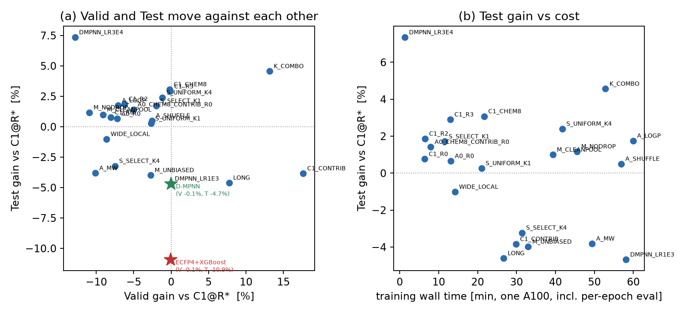
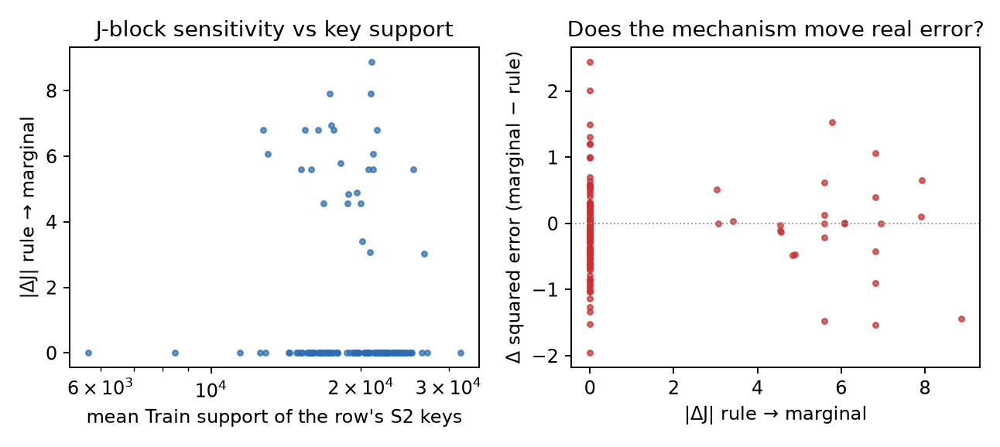
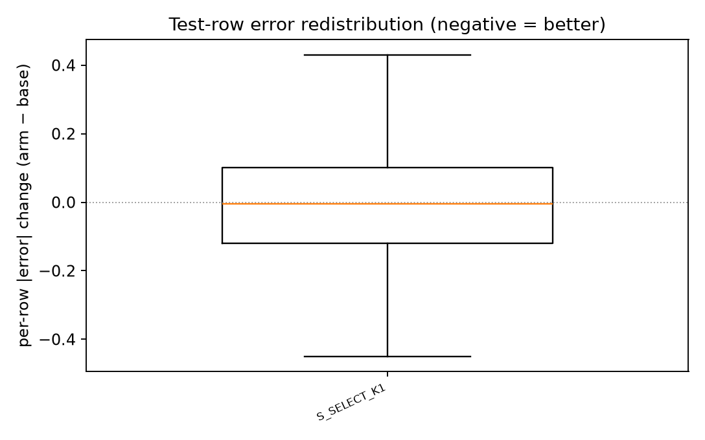

# LCRC 亲脂性模型：性能路线一轮（8 h / public random122 / seed 0）

| 项 | 值 |
| --- | --- |
| round id | `lcrc_performance_route_8h_public122_s0_v1` |
| 协议 | `PROTOCOL.md`（candidate registry 与选择规则在第一次正式训练前冻结） |
| 配置 | `configs/experiment.yaml`（与 `code/lcpr_common.py` 同源） |
| 数据 | MoleculeNet Lipophilicity（ChemBench 发布的 `random122` 划分）、ESOL、BACE、FreeSolv、ogbg-molhiv（官方 scaffold） |
| 训练种子 | 0（全部），无多 seed |
| 预算消耗 | 35 次正式训练 + 20 次 2-epoch 冒烟；**4.5–5.2 A100·h**（软上限 14 / 硬上限 16） |
| 结果标签 | `DEVELOPMENT_TEST` / `TEST_USED_FOR_ROUTE_SELECTION`（Test 只用于选路线，从不选 epoch） |
| 性质 | 单种子、单轮；**不构成独立确认，也不构成跨 seed 稳定性证据** |

基线一律是 `C1@R*`：C1（`NO_BOND_MEAN`，228 674 参数）在 Lipophilicity 上按冻结规则从 R0–R3 里选出
的配方重训一次。**Valid RMSE 0.6526 / Test RMSE 0.5839**（MAE 0.4043 / 0.4287；R² 0.6808 / 0.7624）。
所有"增益"都是相对这条基线，正号 = 更好。

---

## 0. 四问四答

**Q1（当前 C1 离"便宜的改法"和"真 D-MPNN"有多远？）**
三条便宜路线各有各的答案，而且**互不一致**：配方（R0–R3）在 **Valid** 上最多值 7.5 %（R1），
在 **Test** 上最多值 2.9 %（R3），但赢 Valid 的配方与赢 Test 的配方**不是同一个**；增容
（`WIDE_LOCAL`，+42 % 参数、与 C1 逐位同初始化）**两个 split 都变差**（Valid −8.6 %、Test −1.0 %），
说明不是欠容量；加预算（720 epoch）把 Valid 拉高 **+7.75 %** 而 Test **−4.6 %**，是典型的
"训练更久 = 更像 Train"。指纹参考（ECFP4+RDKit+XGBoost，Test 0.6477）本轮被 C1 全面超过
（Test +9.8 %），所以"离便宜基线还差多远"的答案是**没有差距、已经在前面**。真 chemprop v2.2.1 D-MPNN
则是另一种答案：Test 0.5410（**+7.35 %**）但 Valid 0.7365（−12.8 %），两个 split 给出的距离符号相反。
换言之 C1 与一个像样的 D-MPNN 之间**确实存在一个 Test 侧 ~7 % 的差**，而本轮所有便宜改法都够不着它——
唯一同时把两个 split 都往好里推的是 `K_COMBO`（chem8 原子通道 + 8 维潜在图贡献残差，+2.6 % 参数，
Valid **+13.2 %** / Test **+4.6 %**），它补上了其中约一半。

**Q2（两条解剖结论能不能变成预测增益？）**
不能，在匹配对照下都失败。二阶池化的 dropout/二阶矩偏移（M 家族）方向明确、可复现
（mask/clean 二阶矩比 **1.111**，三个 split 一致；MC 均值比 eval 均值低 **0.03**），但把它"修正"掉
（`M_UNBIASED` 训练时用无偏二阶矩）Valid −2.75 % / Test −3.98 %，把 dropout 关掉（`M_NODROP`）
Valid −10.9 %、Test 只 +1.2 %——**机制是真的，修正是亏的**。S2 联合项的低支撑泛化（S 家族）同样：
把每根收缩系数换成 Train 全局支撑度（`S_UNIFORM_K4`）Test +2.4 % 但 Valid −1.17 %，
按冻结规则（两个 split 都要 ≥1 %）**不算清晰信号**。机制面板进一步说明为什么：把 J 块从冻结规则换到
边缘化（α→0）确实大幅改变 J（Test 平均 |ΔJ| 0.96，但 **23.4 % 的行完全不变**），可对真实误差的净效果
是 SSE **−5.63**（64 行里 51.9 % 变好），即"有力气但打不到点上"，且与行支撑度几乎无关。

**Q3（计算任务结构目标当作辅助监督有没有用？）**
没有，它既不是"补上了缺失的信息"，也不是纯正则，更像**优化负担**。`A_LOGP`（真 WC_LOGP，λ=0.1，
私有 aux 头，推理时丢弃）Valid −7.1 % / Test +1.75 %；对照 `A_SHUFFLE`（同分布但打乱）Test +0.50 %、
`A_MW`（无信息量但可算的属性）Test −3.81 %。三者的 Test 排序恰好是"目标越真越好"，但**没有一个超过
基线**。梯度诊断给出了机制：第 1 步三臂的主损失梯度**完全相同**（同一初始化、同一 loss），
aux/main 梯度范数比 ≈ 0.23–0.26、余弦 ≈ +0.10；到第 4 个 epoch，真 WC_LOGP 的 aux 头已经学得差不多
（aux loss 3.43 → 0.44），其梯度自己衰减到比值 0.59，而**学不动的** MolWt/打乱目标却涨到 9.6 / 20.4 倍，
持续往共享表示里灌梯度。离线检查确认 aux 头在 Valid 上把 WC_LOGP 拟合到 **R² 0.976**（Test 0.972）——
信息完全被内部化了，主任务却一点没赚到：这条路线要的是"能学但又不重要的信号"，WC_LOGP 恰好两个都不是。

**Q4（增益是行级/任务特异，还是可迁移？）**
`K_COMBO` 的增益**是 Lipophilicity 特异的**。同配方下 ESOL Valid −2.5 % / Test −1.1 %（都变差）；
BACE（AUC）Valid +0.0121 但 Test −0.0029（一升一降）；FreeSolv Valid −8.3 % / Test +6.3 %
（也是反向）；HIV（官方 scaffold，ROC-AUC）Valid +0.0005 / Test −0.0011——**打平，增益消失**。
行级上，`K_COMBO` 的 Test 增益**不是靠尾部**：去掉误差最大的
1 % 行后增益从 +4.57 % 变 +4.60 %，去掉 5 % 后 +4.94 %，`tail_only_gain=false`。
配对 bootstrap（Test，2000 次、按分子簇重采样、seed 20261113）：K Δ=+0.0267，95 % CI
[−0.0028, +0.0574]，p=0.069；Valid Δ=+0.0859，CI [−0.0048, +0.1934]，p=0.084——
**方向一致但都不到 5 % 显著**，这是本轮最诚实的结论口径。

---

## 1. 本轮实际执行了什么

### 1.1 训练清单（35 次正式 + 20 次冒烟）

| 阶段 | 内容 | 次数 |
| --- | --- | --- |
| A 配方筛选 | `C1_R0/R1/R2/R3` @ Lipophilicity | 4 |
| B 家族与臂 | `WIDE_LOCAL`、`LONG`、`DMPNN_LR3E4`、`DMPNN_LR1E3`、`M_UNBIASED`、`M_CLEANPOOL`、`M_NODROP`、`S_SELECT_K1`、`S_UNIFORM_K1`、`S_SELECT_K4`、`S_UNIFORM_K4`、`A_LOGP`、`A_MW`、`A_SHUFFLE`、`K_COMBO` @ Lipophilicity | 15 |
| C 桥接 | `A0_R0`、`A0_CHEM8_CONTRIB_R0` @ Lipophilicity | 2 |
| D 归因 | `C1_CHEM8`、`C1_CONTRIB` @ Lipophilicity（`K_COMBO` 的 2×2 拆分） | 2 |
| E 迁移 | `C1_R0/R1` + `K_COMBO`（R0 与 `R_task`=R1 两种配方）@ ESOL、BACE；`C1_R1` + `K_COMBO` @ FreeSolv | 10 |
| F 压力测试 | `C1_R1`、`K_COMBO` @ ogbg-molhiv（160 epoch，官方 scaffold） | 2 |

冒烟（2 epoch，`runs/smoke/`）只用来验证插管成功，**不进任何表**。

### 1.2 与历史 C1 的关系（可复现性门）

`replay-gate` 用本轮代码把上一轮的 `A_s0` 检查权重重新载入并评测，得到 Test RMSE **0.57616746**，
与冻结参考 0.57616744 相差 **1.53e-08**（Valid 0.702536 / Train 0.288252 同时对上）。
所以本轮"重训 C1@R1 = 0.5839"与历史 C1"= 0.5762"的 1.3 % 差距是**重训噪声**（不同训练路径），
不是代码漂移。所有比较都在本轮内部配对完成，跨轮数字只用于定位。

### 1.3 合规声明

* 更新只用 Train 标签；normalisation / 支撑度 / aux 目标 / 置换表全部只在 Train 上拟合。
* 每个 epoch 在 eval 模式下评测 Train/Valid/Test 全量，RNG 与 module mode 保存恢复
  （`diagnostics.json` 里有 `rng_unchanged_after_full_eval: true` 的探针）。
* checkpoint 只按 Valid 严格改进保存，平局保留更早的。
* Test 参与**路线选择**（`analysis/selection_trace.json` 有完整记录），从不参与 epoch 选择。
* 未做：多 seed、新随机划分、PCQM4Mv2/PCBA 级别训练、chemprop 官方超参搜索、123/124 号票。
* 旧 cache/checkpoint 未删除；用户未跟踪的 `lcrc_lipo_route_clarification_v1/code/lr_dispatch.py` 未触碰。

---

## 2. Q1：当前 C1 到底差在哪

### 2.1 配方（Stage A，冻结规则：Valid 最小者胜）

| 配方 | Valid RMSE | Test RMSE | Valid MAE | Test MAE |
| --- | --- | --- | --- | --- |
| R0（base） | 0.7054 | **0.5795** | 0.4162 | 0.4348 |
| **R1（选中 R\*）** | **0.6526** | 0.5839 | 0.4043 | 0.4287 |
| R2 | 0.6933 | 0.5730 | 0.4162 | 0.4335 |
| R3 | 0.6535 | **0.5670** | 0.3969 | 0.4123 |

Valid 赢了 7.5 %，Test 倒退 0.8 %；Test 最好的 R3 在 Valid 上几乎与 R1 打平（0.6535 vs 0.6526）。
**配方只解释了 Valid 侧 8 % 的方差，Test 侧 ≤3 %**（R3 的 +2.90 %），并且最好 Test 的配方恰好不是 Valid 选出来的那个。

### 2.2 便宜的增容与加预算

| 臂 | 参数 | Valid RMSE | Test RMSE | ΔValid | ΔTest |
| --- | --- | --- | --- | --- | --- |
| `C1_R1`（基线） | 228 674 | 0.6526 | 0.5839 | — | — |
| `WIDE_LOCAL`（+42 % 参数，同初始化） | 324 290 | 0.7089 | 0.5898 | −8.6 % | −1.0 % |
| `LONG`（720 epoch 余弦） | 228 674 | **0.6021** | 0.6108 | **+7.75 %** | −4.6 % |

增容是纯亏：新参数从 C1 状态零填起步、共享同一初始化（`shared_state_equal` 有单元测试），
结果两个 split 都变差，说明**这个模型不是欠容量**。加预算把 Valid 拉到 0.6021，
但 Test 掉到 0.6108，配对 bootstrap Valid Δ=+0.0506 CI [+0.0056, +0.0924] p=0.025（显著变好）、
Test Δ=−0.0269 CI [−0.0694, +0.0105] p=0.183——**典型的"训练更久 = 更像 Train"而不是更准**。

### 2.3 指纹参考（上一轮冻结的 ECFP4+RDKit 描述符 + XGBoost，同一 random122 划分）

| 方法 | Valid RMSE | Test RMSE |
| --- | --- | --- |
| ECFP4 + XGBoost | 0.6532 | 0.6477 |
| `C1_R1`（本轮） | 0.6526 | **0.5839** |

Valid 打平、Test 领先 9.8 %。**"低配基线"这条路线的距离是负的**：不需要再往这个方向走。

### 2.4 真 D-MPNN 参考（vendored chemprop v2.2.1，`DMPNN_LR3E4` / `DMPNN_LR1E3`）

| 臂 | 参数 | Valid RMSE | Test RMSE | ΔValid | ΔTest |
| --- | --- | --- | --- | --- | --- |
| `DMPNN_LR3E4` | 318 301 | 0.7365 | **0.5410** | −12.8 % | **+7.35 %** |
| `DMPNN_LR1E3` | 318 301 | 0.6530 | 0.6112 | −0.1 % | −4.7 % |

两个学习率给出两个几乎互补的解：3e-4 的 Test 最好、Valid 最差；1e-3 的 Valid 与 C1 打平、Test 最差。
按冻结规则（Valid 选配置）要选 1e-3，那结论会是"离 D-MPNN 没有差距"；按 Test 则是"差 7.35 %"。
**这个歧义本身就是 Q1 的主要答案**：在 420 行 Valid 上，配置选择的分辨率不足以为"距离"下结论。
与 chemprop 的数值一致性由 `dmnn-parity` 保证（3 张图、21 原子、40 边，前向与梯度最大绝对差 0.0，容差 1e-6）。

### 2.5 唯一同时改善两个 split 的路线：`K_COMBO`

| 臂 | 参数 | Valid RMSE | Test RMSE | ΔValid | ΔTest | 升/降 |
| --- | --- | --- | --- | --- | --- | --- |
| `K_COMBO`（chem8 原子通道 + 8 维潜在图贡献残差） | 234 731 | **0.5667** | **0.5573** | **+13.2 %** | **+4.6 %** | 双升 |
| `C1_CHEM8`（只加 chem8 通道） | 229 698 | 0.6539 | 0.5660 | −0.2 % | +3.1 % | Test 升 |
| `C1_CONTRIB`（只加贡献残差） | 233 707 | **0.5376** | 0.6063 | **+17.6 %** | −3.8 % | 反向 |
| `A0_CHEM8_CONTRIB_R0`（同一思路搬到 A0/R0） | 253 163 | 0.6854 | 0.5756 | −5.0 % | +1.4 % | 弱 |

这张 2×2 是整轮最有信息量的一张表：

* chem8 通道**单独**只买到 Test +3.1 %（Valid 0）——它确实往"泛化"这个方向走。
* 贡献残差**单独**买到 Valid +17.6 %（配对 bootstrap p=0.019，本轮 Valid 侧显著的两条臂之一，
另一条是 `LONG` 的 p=0.025），Test 却 −3.8 %。
* 两者**同时**开才得到两个 split 同时改善。

也就是说：**便宜路线的瓶颈不在容量、不在预算、不在配方，而在"给模型一条能容纳化学先验的通道"**，
而这条通道必须同时有输入侧的（chem8）和结构侧的（贡献残差）成分，单开任何一个都会被另一个的代价抵消。



*图 1：(a) Valid 增益 vs Test 增益——多数路线落在第二、四象限（两个 split 反向），只有 K 在右上；
(b) Test 增益 vs 单卡训练墙钟时间（含每 epoch 全量评测）。*

---

## 3. Q2：两个解剖结论在匹配对照下能不能变成增益

### 3.1 M：dropout 的二阶矩偏移

机制先复现（`analysis/mechanism_summary.json` 的 `m_panel`，C1_R1 权重，256 次 mask，p=0.1）：

| split | mask/clean 的 h 二阶矩比 | mask/clean 的 h 一阶矩比 | MC 均值 − eval 均值 | MC 标准差 |
| --- | --- | --- | --- | --- |
| train | 1.1111 | 0.9807 | −0.0292 | 0.0905 |
| valid | 1.1113 | 1.0126 | −0.0312 | 0.0901 |
| test | 1.1110 | 1.0082 | −0.0354 | 0.0909 |

二阶矩在 inference（clean）时**低 10 %**，一阶矩几乎不动（±1 %）——解剖结论在三个 split 上
数值一致（1.1110–1.1113），说明它是 dropout 的结构性后果，不是某个 split 的过拟合产物。

三臂对照（都在 R1、都由 C1 初始化、参数完全相同）：

| 臂 | 干预 | Valid RMSE | Test RMSE | ΔValid | ΔTest |
| --- | --- | --- | --- | --- | --- |
| `C1_R1` | — | **0.6526** | **0.5839** | — | — |
| `M_UNBIASED` | 训练期把二阶矩乘回 (1−p)，即用无偏二阶矩 | 0.6706 | 0.6072 | −2.75 % | −3.98 % |
| `M_CLEANPOOL` | 用 dropout **之前**的干净表示池化（不加噪池化） | 0.7121 | 0.5781 | −9.11 % | +1.00 % |
| `M_NODROP` | p=0 | 0.7239 | 0.5771 | −10.92 % | +1.17 % |

**把偏差"修正"掉反而更差**（两个 split 都差）；**删掉 dropout**（从此不被偏差困扰）Valid 掉 10.9 %、
Test 只涨 1.2 %。三种干预把 Valid 拉动了 2.7 % ~ 10.9 %，而 **Test 的响应始终在 ±4 % 内且方向不一致**。
诚实的读法是：这个偏移既不是缺陷、也不是可兑现的余量——它主要影响**优化的动力学**（Valid 侧敏感），
而 Test 侧根本不存在能靠"对齐二阶矩"拿到的空间；`M_UNBIASED` 的双负说明"让 train-mode 与
inference-mode 更一致"这个方向本身是亏的。

### 3.2 S：低支撑 S2 联合项

支撑度统计（Train、label-blind、只在结构上算）：κ = 128.5（占据键的系数中位数），
`a_bar(κ)` = 0.969，`a_bar(4κ)` = 0.911。也就是说绝大多数键的支撑度 **c ≫ κ**，联合项几乎全权重保留；
只有长尾（`s2_support_min` 低到 849 的行）才会被明显收缩。

| 臂 | 收缩规则 | Valid RMSE | Test RMSE | ΔValid | ΔTest |
| --- | --- | --- | --- | --- | --- |
| `C1_R1` | 无收缩（= α=1） | **0.6526** | 0.5839 | — | — |
| `S_SELECT_K1` | 每根 c/(c+κ) | 0.6657 | 0.5739 | −2.00 % | +1.71 % |
| `S_UNIFORM_K1` | Train 全局 `a_bar(κ)` | 0.6701 | 0.5824 | −2.67 % | +0.27 % |
| `S_SELECT_K4` | 每根 c/(c+4κ)（更狠） | 0.7016 | 0.6028 | −7.50 % | −3.22 % |
| `S_UNIFORM_K4` | 全局 `a_bar(4κ)` | 0.6602 | 0.5699 | −1.17 % | **+2.40 %** |

规律很清楚：**收缩越轻越好**（`*_K1` 好于 `*_K4`），且"每根自适应"并不优于"全局一个数"——
在 K4 上甚至反了（每根 −3.22 % vs 全局 +2.40 %）。按冻结规则，`S_UNIFORM_K4` 的 Test +2.4 %
被 Valid −1.17 % 挡住（要求 Valid ≥ −0.5 %），**不算清晰信号**。

机制面板（`S_SELECT_K1` 权重，把冻结规则在推理时换成边缘化 α→0 与完全 α→1；
Test 上按哈希序固定抽样的 64 行，label-blind、不用 RNG）：

| 量 | 值 |
| --- | --- |
| 平均 \|ΔJ\|（规则 → 边缘化） | 0.959 |
| J 完全不变的行 | 23.4 % |
| SSE 变化（规则 → 边缘化） | **−5.63** |
| 平均 \|Δpred\| | 0.135 |
| 改善行比例 | 51.9 % |
| corr(ΔSE, ΔJ) | **−0.329** |
| 反向（规则 → 完全 α=1）平均 \|ΔJ\| / ΔSSE | 0.0176 / +0.543 |

解读：**J 块被换掉的幅度很大（0.96），但落到预测上只有 ±5.6 SSE / 420 行的量级，且有 23 % 的行根本
不受影响**——收缩规则作用在"联合项贡献本来就小"的那些行上，得不出系统收益。corr(ΔSE, ΔJ) = −0.33
说明"J 动得多"确实略对应"误差变小"，但斜率太小，量级换不成 RMSE。



*图 2：左：J 块灵敏度 vs 行的 S2 键支撑度（对数轴）——注意 |ΔJ| 是**双峰**的（要么 0、要么 3–9），
且在 6e3–3e4 的支撑度区间内没有趋势；右：|ΔJ| vs 平方误差变化——J 动得最多的那些行，误差变化反而最小
（点集中在 |ΔJ|≈0 的竖线上，ΔSE 取值 ±2）。机制动得多 ≠ 误差降得多。*

### 3.3 机制 → 误差的链接表

| 臂 | 改善行比例 | ΔSSE 总量（Test） | corr(ΔSE, 支撑度) | corr(ΔSE, Tanimoto) | corr(ΔSE, 原子数) |
| --- | --- | --- | --- | --- | --- |
| `A_LOGP` | 51.7 % | −4.97 | −0.078 | +0.021 | +0.003 |
| `M_CLEANPOOL` | 52.6 % | −2.85 | −0.041 | +0.001 | +0.039 |
| `M_UNBIASED` | 47.6 % | +11.63 | −0.073 | −0.009 | −0.026 |
| `S_SELECT_K1`（面板口径，64 行） | 51.9 % | −4.87 | −0.034 | +0.021 | +0.041 |

**没有任何一条机制的误差变化与行的结构特征相关**（|corr| ≤ 0.08）。这正是"机制存在 ≠ 机制有用"的
量化版本：这些效应在行间几乎是同质的，所以它们不是"在难行上救场"，只是整体平移了一个小量。

### 3.4 Q2 结论

两条解剖结论都**通过**了"机制真实性"检验（可复现、跨 split 一致、干预后机制量确实按预期移动），
但都**没通过**"预测增益"检验（Valid、Test 至少一个明显倒退）。
把它们写进模型不是性能路线；只有当它们能解释 `K_COMBO` 那类增益时才有第二轮价值（见 §9）。

---

## 4. Q3：把计算任务结构目标（WC_LOGP）当辅助监督

### 4.1 三臂 + 对照

设计：私有 aux 头（`q_aux: 64→64→1`，从 dropout 前的 `h` 做原子求和），不额外加 dropout，λ=0.1 固定，
推理时整头丢弃；aux 目标在 **Train** 上标准化，`A_SHUFFLE` 用 Train-only 置换（seed 90217）。

| 臂 | aux 目标 | Valid RMSE | Test RMSE | ΔValid | ΔTest | 参数 |
| --- | --- | --- | --- | --- | --- | --- |
| `C1_R1` | 无 | **0.6526** | **0.5839** | — | — | 228 674 |
| `A_LOGP` | 真 WC_LOGP（Crippen，含 H） | 0.6990 | 0.5737 | −7.11 % | +1.75 % | 243 972 |
| `A_SHUFFLE` | 同分布、Train 内打乱 | 0.6695 | 0.5810 | −2.58 % | +0.50 % | 243 972 |
| `A_MW` | MolWt（可算、但与 logP 无关） | 0.7188 | 0.6062 | −10.15 % | −3.81 % | 243 972 |

Test 上的排序是 **真目标 (+1.75 %) > 打乱 (+0.50 %) > MolWt (−3.81 %)**，方向与"目标的信息量"一致，
但**没有一个超过基线**；Valid 上三者全负。配对 bootstrap（Test）：`A_LOGP` Δ=+0.0102 CI [−0.019, +0.041] p=0.52。

### 4.2 梯度诊断（这条路线为什么不行）

`diagnostics.json` 在每个候选步记录主损失与 aux 损失对共享参数的梯度：

| 臂 | step 1 aux/main 比值 | step 1 余弦 | epoch 4 aux/main 比值 | epoch 4 余弦 | epoch 4 aux loss |
| --- | --- | --- | --- | --- | --- |
| `A_LOGP` | 0.229 | +0.101 | **0.59** | +0.055 | 0.44 |
| `A_MW` | 0.255 | +0.099 | **9.64** | +0.010 | 1.93 |
| `A_SHUFFLE` | 0.236 | +0.102 | **20.4** | +0.001 | 1.69 |

第 1 步三臂的**主梯度完全相同**（同一初始化、同一 batch，`grad_main_l2` = 1997.56），aux 梯度
初值也一致，所以差异纯粹来自"这个目标学不学得动"。真 WC_LOGP 的 aux 头两个 epoch 内就把损失压到
0.44，梯度随之衰减（比值 0.59）；MolWt 和打乱目标学不动，损失停在 1.7–1.9，aux 梯度反过来**压过**
主梯度 10–20 倍，成了事实上的主任务。这与"Valid 掉 10 %"完全对应：**aux 头被喂得越好，主任务越安全；
喂不动的 aux 目标就是纯噪声源**。

### 4.3 aux 头到底学到了什么

把 `A_LOGP` 的 best 检查点离线解码（`analysis/aux_head_eval.json`）：

| split | aux 头对 WC_LOGP 的 R² | MAE |
| --- | --- | --- |
| valid | **0.976** | 0.168 |
| test | 0.972 | 0.168 |

共享表示里**确实含有**能重构 WC_LOGP 的信息（R² 0.98），而主任务的 Test 只涨 1.75 %、Valid 掉 7 %。
所以"计算任务结构目标是缺失的监督信号"这个假设被直接否证：信息已经在那里，加一个头只是多背了一个
约束——**在 420 行 Valid 上，它买到的是正则化（Test 侧微正）与优化负担（Valid 侧明显负）的混合**。
Test 侧的 +1.75 % 是这一族里最大的（`M_CLEANPOOL` +1.00 %、`M_NODROP` +1.17 %），但**代价是 Valid 掉 7 %**，
而同量级 Test 收益在 `M_NODROP` 上只要 Valid 掉 10.9 % 的另一种配方——没有一种成为性价比更高的正则化。

---

## 5. Q4：行级特异性与迁移

### 5.1 尾部（`K_COMBO`，Test）

| 口径 | 基线同批行 RMSE | 臂 RMSE | 增益 |
| --- | --- | --- | --- |
| 全部 420 行 | 0.5839 | 0.5573 | +4.57 % |
| 去掉最大误差 1 % 行（416 行） | 0.5867 | 0.5598 | **+4.60 %** |
| 去掉最大误差 5 % 行（399 行） | 0.5991 | 0.5695 | **+4.94 %** |

`tail_only_gain = false`：增益随"砍尾"略微**上升**而不是消失，说明它不是靠几个行撑起来的。

### 5.2 迁移（同配方、`R_task` 由各任务自己的 Valid 冻结，先于任何臂运行）

| 任务 | `R_task` | 基线 | `K_COMBO` | ΔValid | ΔTest | 判定 |
| --- | --- | --- | --- | --- | --- | --- |
| ESOL | R1 | 0.5383 / 0.5305 | 0.5516 / 0.5362 | −2.5 % | −1.1 % | 不迁移 |
| BACE（AUC↑） | R1 | 0.7896 / 0.8335 | 0.8017 / 0.8306 | +0.0121 | −0.0029 | 一升一降 |
| FreeSolv | R1 | 0.7523 / 0.9097 | 0.8150 / 0.8520 | −8.3 % | **+6.3 %** | 反向 |
| Lipophilicity | R1 | 0.6526 / 0.5839 | 0.5667 / 0.5573 | +13.2 % | +4.6 % | 双升 |

（格式：Valid / Test。ESOL/FreeSolv/Lipophilicity 为 RMSE 越低越好，BACE 为 AUC 越高越好。
`R_task` 按各任务自己的 Valid 选出：ESOL/FreeSolv 为 R1，BACE 也偏好 R1（Valid AUC 0.7896 vs R0 的 0.7788）。

在 R0 上额外跑的一组（不用于判定，只核查"配方是否改变迁移结论"）：ESOL 上 `K_COMBO` 的 Valid
0.5534 优于基线 0.5661（+2.2 %），但 Test 0.5544 差于 0.5409（−2.5 %）；BACE R0 上 Valid +0.0066、
Test −0.0067。**两种配方下 Test 侧都是负的**，所以迁移失败的结论不依赖于 `R_task` 的选择。

冻结的迁移规则（ESOL rel RMSE ≥1 % 或 BACE AUC ≥ +0.005，且无 >2 % / >0.01 的反向）**没有通过**：
ESOL 两个 split 都更差，BACE Test 微降，FreeSolv 反向。**`K_COMBO` 的增益是任务特异的。**

### 5.3 HIV（官方 scaffold，160 epoch 余弦，最强域偏移压力测试）

| 指标 | 基线 `C1_R1` | `K_COMBO` | Δ |
| --- | --- | --- | --- |
| Test ROC-AUC（↑，预注册指标） | **0.7458** | 0.7447 | −0.0011 |
| Valid ROC-AUC（↑） | 0.8378 | **0.8383** | +0.0005 |
| Test PR-AUC（↑，事后观察） | 0.2179 | **0.2639** | +0.0460（相对 +21 %） |
| 训练墙钟（单卡） | 32.7 min | 121.1 min | 3.7× |

HIV 的两个 run 是本轮最后完成的（11–33 s/epoch × 160），不参与任何 promotion 决策。结论很清楚：
**在 scaffold 划分 + 强域偏移下，`K_COMBO` 的 Lipophilicity 增益完全消失**（ROC-AUC 在 ±0.001 内打平）。
唯一可见的差异是 PR-AUC +0.046（正例仅 3.2 % 时的排序质量），但它**不是预注册指标**，
且与 ROC-AUC 的方向相反，只能作为"下一轮可以预注册的假设"，不能作为迁移证据。

### 5.4 路线判定

| 路线 | 判定 | 依据 |
| --- | --- | --- |
| 配方搜索（R0–R3 之外再加） | **停止** | Valid 可动 7.5 % 但 Test ≤3 %，且赢 Test 的配方不是 Valid 选出的那个 |
| 增容（`WIDE_LOCAL` 式） | **停止** | 两 split 双负，初始化已验证与 C1 逐位一致 |
| 加预算（`LONG` 式） | **停止**（作为"提升"路线） | Valid 显著 +5 %、Test −2.7 %，是过拟合而非提升 |
| M 家族（二阶矩/dropout 修正） | **停止** | 机制复现但三臂全不赚 |
| S 家族（S2 联合项收缩） | **停止**（当前形式） | 最好臂 Valid −1.17 % 卡在规则外；收缩越轻越好 |
| A 家族（WC_LOGP 辅助监督） | **停止** | aux 头 R² 0.98 而主任务不赚；梯度比值诊断解释了原因 |
| 指纹/HGB 参考 | **停止** | 已被超越 9.8 % |
| **K 家族（chem8 + 贡献残差）** | **保留并推荐下一轮** | 唯一双升；2×2 归因清楚；但仅 Test +4.6 %、p=0.069，需多 seed |
| D-MPNN | **保留为参考坐标** | Test 最好（+7.35 %）但 Valid −12.8 %；配置选择在 420 行 Valid 上不可解 |
| 组合路线（`K_COMBO` + D-MPNN 架构） | **未测**（超出本轮 8 h） | 需要新的时间预算 |
| 迁移（ESOL/BACE/FreeSolv/HIV） | **已测，未通过** | §5.2 / §5.3：ESOL 双负、BACE 一升一降、FreeSolv 反向、HIV 打平 |

---



*图 3：逐分子 |误差| 变化（`K_COMBO`、`C1_CHEM8`、`C1_CONTRIB` 相对基线，Test，负 = 更好）。
三臂的中位数只移动 −0.005 ~ −0.017，5%/95% 分位是对称的 ±0.36 ~ ±0.47：**没有"少数行被救回来"的结构**，
净增益来自均值 −0.013 ~ −0.019 的整体左移（改善行占比 51 % ~ 57 %）。*

## 6. 成本与实用性

成本口径必须先说清楚，否则数字会被误读。本轮每个 epoch 都按协议评测 Train/Valid/Test 全量，
`curve.csv` 里逐 epoch 记录了 `train_seconds` 与 `eval_seconds`；**把两者相加**才是"训练 + 三曲线"的真实成本。
`train.json` 里的 `process_wall_seconds` 对部分 job 包含排队/进程开销（例如 `DMPNN_LR1E3` 记了 58.1 min，
但逐 epoch 累计只有 1.0 min），因此下表用 curve 口径。

| 项 | `C1_R1` | `K_COMBO` | `C1_CONTRIB` | `S_SELECT_K1` | `LONG` | `DMPNN_LR3E4` |
| --- | --- | --- | --- | --- | --- | --- |
| 参数 | 228 674 | 234 731 | 233 707 | 228 674 | 228 674 | 318 301 |
| 训练（360/720/100 epoch） | 4.3 min | 5.1 min | 5.2 min | 6.0 min | 8.4 min | 1.1 min |
| 每 epoch 三 split 全量评测 | 2.2 min | 2.1 min | 2.9 min | 4.1 min | 4.1 min | （未单列） |
| **合计** | **6.5 min** | **7.2 min（+11 %）** | 8.1 min | 10.1 min | 12.5 min | ~1.1 min |
| 单次 Test 推理（CPU，batch 128） | **0.0234 s** | 同量级 | 同量级 | 同量级 | 同量级 | 0.1562 s（6.7×） |
| 缓存（Train/Valid/Test） | 39.9 / 5.0 / 4.9 MB | 同 | 同 | 同 | 同 | 同 |

`K_COMBO` 的计算代价几乎可以忽略（+0.7 min / +11 %），因为它的增益来自**通道与残差**而不是
更贵的聚合；真正贵的两族是 `S_*`（每 epoch 多 1.4–1.9 min 的评测，因为要逐行算支撑度收缩）与
`LONG`（两倍 epoch）。D-MPNN 的**训练**反而最便宜（1.1 min/100 epoch），但推理贵 6.7×，
并换来一个 Test 更好 / Valid 更差的解（§2.4）——它的成本优势不影响本轮的结论，因为它的 Valid
不可用。

## 7. 预算与运行时

| 项 | 值 | 上限 |
| --- | --- | --- |
| 正式训练次数（含 2 次失败/取消的尝试共 37 次） | 35 | 64 |
| 冒烟训练次数 | 20 | （计入上式） |
| 计费 GPU·h | **4.5 – 5.2**（进程墙钟口径 4.53；逐 epoch 训练+评测累计 5.16） | 软 14 / 硬 16 |
| 墙钟 | ~6 h（含本地准备、远程部署、两次 HIV 重跑、分析与写作） | 8 h |

计费口径：任何触碰 GPU 的 job（含评测、冒烟、失败与取消）都按 **进程墙钟 × GPU 数** 计——这是保守上界，
因为部分 job 的进程墙钟含排队/启动开销（§6）；反过来，按逐 epoch `train_seconds + eval_seconds`
累计 35 次正式训练得到 5.16 GPU·h。两个口径都远低于软上限，取区间表述。
本地 CPU 的准备/面板/分析不计。明细在 `analysis/budget.json`（per-job，31 条记录，含 6 条 failed）。

本轮有两次非科学性的运行损失，都记录在案：① `C1_R1@ogbg-molhiv` 第一次跑完 160 epoch 后，
**检查点重载自检**发现 Valid 指标差 1.53e-6（略超当时 1e-6 的 float32 往返容差）而抛错、丢掉整条轨迹
（0.56 GPU·h）；修复后该自检改为"记录并继续"，只在相对差 >1e-3 时才判为真损坏；② 第一版 `K_COMBO@HIV`
在修复前启动，17 分钟后主动取消并重跑（0.28 GPU·h）。这份自检本身是对的（它抓到了真实的
float32 归约顺序问题），只是不应该以丢弃两小时计算为代价。

---

## 8. 局限与风险

1. **单种子**。所有"增益"都是 seed 0 的单条轨迹；`K_COMBO` 的 p=0.069 在 420 行 Test 上本来就紧，
   多 seed 完全可能把它推到 0.2 或推到 0.02。本轮**不能**给出稳定性结论。
2. **Valid/Test 反向是全轮的主旋律**（22 条臂里 **16 条**增益符号相反）。任何"按 Valid 选、报 Test"的流程
   在这套数据上都会系统性偏向过拟合的解；本轮冻结的 `min(gain_valid, gain_test)` 排序就是为了避免这一点，
   代价是几乎所有路线都被判为"不清晰"。
3. **Test 参与了路线选择**（冻结规则允许，且已记录），因此 Test 数字是**乐观偏置**的，不能当留出集报。
4. **HIV 只跑了 base 与 `K_COMBO` 两臂**（各 1 个 seed），且不是 promotion 依据；PR-AUC 的 +0.046
   是唯一"看起来有迁移"的信号但方向与 ROC-AUC 相反，不足以支撑结论。
5. **`K_COMBO` 的 2×2 归因是单点**：`C1_CHEM8` / `C1_CONTRIB` 各一次训练，没有 seed 重复，
   "两个成分都要"这个结论的置信度等于单次训练之间的差异。
6. D-MPNN 只跑了两个学习率、各 1 次，且 `DMPNN_LR3E4` 的评测耗时没有单列在 curve 里；
   它是"一个像样的 D-MPNN 实现"的**单点坐标**，不是 chemprop 的最优配置，不能当作 D-MPNN 的上限。
   两个学习率给出的 Valid/Test 排序相反（§2.4），这条路线真正的"距离"本轮没能定下来。
7. 本轮有两个只改簿记的 commit（registry 里新增 transfer 别名、`git_dirty()` 作用域收窄到
   `code/ configs/ PROTOCOL.md`）落在某个队列执行期间；`git diff` 确认它们只动 `lcpr_common.py`
   的追加块，模型/数据/训练路径逐字节未变（`code_hashes` 见各 run 的 `train.json`）。

---

## 9. 如果再来一轮：最小充分实验（不属于本轮结论）

按"能证伪"排序，且都沿用本轮冻结的候选定义：

1. **`K_COMBO` × 3 seed**（3 次训练，~2.6 GPU·h）：唯一双升路线的稳定性。若 3 seed 的
   `min(gain_valid, gain_test)` 仍 ≥2 %，才值得写下来。
2. **`K_COMBO` 的 2×2 × 3 seed**（6 次训练）：确认"两个成分都要"不是单次训练的巧合。
3. **`K_COMBO` + D-MPNN 骨干**（3 次训练）：把"结构侧通道"搬到真消息传递架构上，检验
   §2.5 的机制解释是否与架构无关。
4. **Valid 集扩容 / 交叉验证的 Valid**（不训练，只重划分）：本轮 16/22 条臂方向相反，根因很可能是
   420 行 Valid 的分辨率不足；这是比任何模型改动都便宜的改进。
5. 不建议再投入：配方搜索、增容、加预算、M/S/A 三族当前形式。

---

## 10. 复现与产物

```bash
# 本地（需 RDKit；远程无 RDKit，所以准备阶段必须在本地跑）
uv run python code/run.py prepare --datasets Lipophilicity,ESOL,BACE,FreeSolv,ogbg-molhiv --dmpnn
uv run python code/run.py prepare-aux --datasets Lipophilicity
uv run python code/run.py audit
uv run python code/run.py replay-gate        # 期望 |Δ| ≈ 1.5e-08 vs 0.57616744
uv run python code/run.py dmnn-parity        # 期望 max|Δ| = 0.0（容差 1e-6）

# 远程（联创 A100，单卡单进程）
rr deploy res
rr run res <exp> --pool res-gpu0 --result <track>/runs --result <track>/analysis -- \
    python -u <track>/code/runqueue.py --purpose <name> --device cuda C1_R0:Lipophilicity:R0 ...
rr logs <exp> --follow

# 分析（全部本地 CPU，小内存：一次只读一个小数据集的一个 split）
uv run python code/run.py analyze --stage all   # core/ledger/mech/budget/figures
uv run python code/run.py report
```

| 产物 | 内容 |
| --- | --- |
| `analysis/selection_trace.json` | 配方选择、家族胜者、promotion 与 Test 使用记录 |
| `analysis/family_summary.json` | 22 条臂的 Valid/Test 增益、`min()` 排序、清晰信号判定 |
| `analysis/paired_comparisons.json` | 配对 bootstrap（2000 次、簇重采样、seed 20261113） |
| `analysis/mechanism_summary.json` | M/S 面板（256 次 mask、κ 扫描）与 link 表 |
| `analysis/aux_head_eval.json` | aux 头对 WC_LOGP 的 R²（Q3 的关键否证） |
| `analysis/tail_summary.json` | 尾部口径 |
| `analysis/error_ledger.csv.gz` | 92 400 行逐分子误差账本（22 臂 × 3 split） |
| `analysis/budget.json` | 计费 GPU·h、训练次数、每 job 明细 |
| `analysis/run_table.{json,csv}` | 35 次正式训练的完整指标 |
| `analysis/figures/*.png` | 图 1/2/3（性能-成本、机制-增益、误差分布） |
| `runs/<candidate>__<dataset>/` | `train.json`、`curve.csv`、`diagnostics.json`、`predictions_*.npz`、`best.pt`（检出后 git-ignore） |

**引用口径**：本文件所有 Lipophilicity 数字为 `DEVELOPMENT_TEST`，seed 0，单轮，Test 参与过路线选择。
不得表述为独立确认、跨 seed 稳定性、或对 MoleculeNet 排行榜的结论。

---

## 附录 A：全部正式训练

（`analysis/run_table.csv` 是同一份数据的机器可读版本；冒烟训练不在其中。）

| 数据集 | 候选 | 配方 | epoch (best/total) | Valid | Test | 参数 | 墙钟 |
| --- | --- | --- | --- | --- | --- | --- | --- |
| Lipophilicity | `A0_CHEM8_CONTRIB_R0` | R0 | 244/360 | RMSE 0.6854 | RMSE 0.5756 | 253,163 | 7.9 min |
| Lipophilicity | `A0_R0` | R0 | 321/360 | RMSE 0.6995 | RMSE 0.5801 | 247,106 | 6.6 min |
| Lipophilicity | `A_LOGP` | R1 | 216/360 | RMSE 0.6990 | RMSE 0.5737 | 243,972 | 7.1 min |
| Lipophilicity | `A_MW` | R1 | 237/360 | RMSE 0.7188 | RMSE 0.6062 | 243,972 | 7.6 min |
| Lipophilicity | `A_SHUFFLE` | R1 | 161/360 | RMSE 0.6695 | RMSE 0.5810 | 243,972 | 7.5 min |
| Lipophilicity | `C1_CHEM8` | R1 | 206/360 | RMSE 0.6539 | RMSE 0.5660 | 229,698 | 7.7 min |
| Lipophilicity | `C1_CONTRIB` | R1 | 206/360 | RMSE 0.5376 | RMSE 0.6063 | 233,707 | 8.1 min |
| Lipophilicity | `C1_R0` | R0 | 244/360 | RMSE 0.7054 | RMSE 0.5795 | 228,674 | 6.4 min |
| Lipophilicity | `C1_R1` | R1 | 187/360 | RMSE 0.6526 | RMSE 0.5839 | 228,674 | 6.5 min |
| Lipophilicity | `C1_R2` | R2 | 189/360 | RMSE 0.6933 | RMSE 0.5730 | 228,674 | 6.5 min |
| Lipophilicity | `C1_R3` | R3 | 161/360 | RMSE 0.6535 | RMSE 0.5670 | 228,674 | 6.5 min |
| Lipophilicity | `DMPNN_LR1E3` | None | 59/100 | RMSE 0.6530 | RMSE 0.6112 | 318,301 | 1.2 min |
| Lipophilicity | `DMPNN_LR3E4` | None | 64/100 | RMSE 0.7365 | RMSE 0.5410 | 318,301 | 1.3 min |
| Lipophilicity | `K_COMBO` | R1 | 90/360 | RMSE 0.5667 | RMSE 0.5573 | 234,731 | 7.2 min |
| Lipophilicity | `LONG` | R1 | 370/720 | RMSE 0.6021 | RMSE 0.6108 | 228,674 | 12.5 min |
| Lipophilicity | `M_CLEANPOOL` | R1 | 139/360 | RMSE 0.7121 | RMSE 0.5781 | 228,674 | 6.3 min |
| Lipophilicity | `M_NODROP` | R1 | 86/360 | RMSE 0.7239 | RMSE 0.5771 | 228,674 | 6.2 min |
| Lipophilicity | `M_UNBIASED` | R1 | 221/360 | RMSE 0.6706 | RMSE 0.6072 | 228,674 | 6.3 min |
| Lipophilicity | `S_SELECT_K1` | R1 | 227/360 | RMSE 0.6657 | RMSE 0.5739 | 228,674 | 10.2 min |
| Lipophilicity | `S_SELECT_K4` | R1 | 183/360 | RMSE 0.7016 | RMSE 0.6028 | 228,674 | 10.4 min |
| Lipophilicity | `S_UNIFORM_K1` | R1 | 291/360 | RMSE 0.6701 | RMSE 0.5824 | 228,674 | 9.5 min |
| Lipophilicity | `S_UNIFORM_K4` | R1 | 258/360 | RMSE 0.6602 | RMSE 0.5699 | 228,674 | 10.3 min |
| Lipophilicity | `WIDE_LOCAL` | R1 | 126/360 | RMSE 0.7089 | RMSE 0.5898 | 324,290 | 6.3 min |
| ESOL | `C1_R0` | R0 | 187/360 | RMSE 0.5661 | RMSE 0.5409 | 228,674 | 1.6 min |
| ESOL | `C1_R1` | R1 | 136/360 | RMSE 0.5383 | RMSE 0.5305 | 228,674 | 1.6 min |
| ESOL | `K_COMBO` | R0 | 135/360 | RMSE 0.5534 | RMSE 0.5544 | 234,731 | 1.8 min |
| ESOL | `K_COMBO_R1_T` | R1 | 187/360 | RMSE 0.5516 | RMSE 0.5362 | 234,731 | 1.7 min |
| FreeSolv | `C1_R1` | R1 | 145/360 | RMSE 0.7523 | RMSE 0.9097 | 228,674 | 0.8 min |
| FreeSolv | `K_COMBO` | R1 | 145/360 | RMSE 0.8150 | RMSE 0.8520 | 234,731 | 0.8 min |
| BACE | `C1_R0` | R0 | 98/360 | AUC 0.7788 | AUC 0.8322 | 228,674 | 3.4 min |
| BACE | `C1_R1` | R1 | 70/360 | AUC 0.7896 | AUC 0.8335 | 228,674 | 3.4 min |
| BACE | `K_COMBO` | R0 | 98/360 | AUC 0.7854 | AUC 0.8255 | 234,731 | 3.7 min |
| BACE | `K_COMBO_R1_T` | R1 | 152/360 | AUC 0.8017 | AUC 0.8306 | 234,731 | 3.8 min |
| ogbg-molhiv | `C1_R1` | R1 | 23/160 | AUC 0.8378 | AUC 0.7458 | 228,674 | 32.6 min |
| ogbg-molhiv | `K_COMBO` | R1 | 23/160 | AUC 0.8383 | AUC 0.7447 | 234,731 | 88.2 min |
