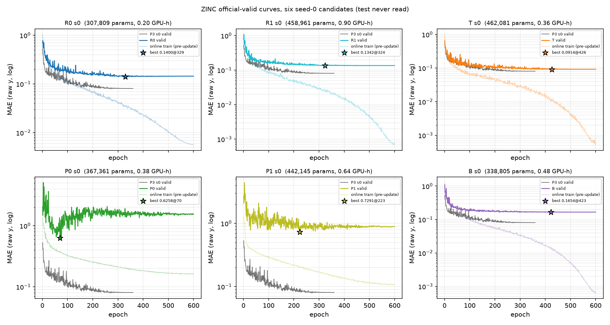
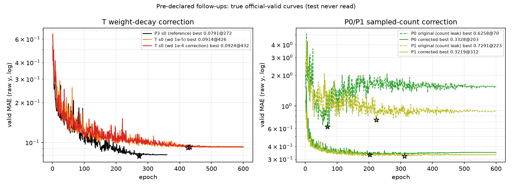

# ZINC architecture-discovery v1 — round report

**Status:** closed. Six seed-0 candidates plus three pre-declared follow-ups were
trained and evaluated on the official ZINC valid split. After every checkpoint
and selection was frozen, one terminal test pass was added at the user's request
for a generalization check; test was not used to choose a model, recipe, epoch,
or checkpoint. The round did not find a model that beats the historical P3
seed-0 reference on the same valid split, and T remains above a direct P3 test
evaluation as well.

## 1. Protocol and boundary

- Data: official PyG ZINC subset, train 10,000 / valid 1,000; raw-y MAE; full
  valid evaluated every epoch; best checkpoint selected by strict `<` (earlier
  epoch wins a tie).
- Valid drove all development, comparison, and checkpoint selection. Test was
  read once at the very end, after the models were frozen, for a descriptive
  generalization check. It did not influence any model, recipe, epoch, or
  checkpoint choice. Original P0/P1 were not scored because their sampled-count
  readout is invalid and their old reader shape is not loadable by the corrected
  model.
- Every reported model is ≤ 500,000 learnable parameters; no VQ, no codebook, no
  EMA cache, no local recursive message passing, no target-derived features.
- Static neighborhood/path/block features were precomputed from the raw
  atom/bond graph. No multi-round neighbor hidden-state updates are used.
- Only T loads the existing train-only P3 masked-SSL encoders; they are
  fine-tuned in the supervised phase, not frozen. R0/R1/P0/P1/B use random
  initialization. P3 is the historical frozen-SSL reference; its training was not
  rerun, but its frozen checkpoints were used for the terminal test evaluation.
- Training code: `code/` at commit `91b81bb` (plus the report/plot files in the
  final report commit). The full six-candidate design record, including feature
  definitions and pre-declared corrections, is in `DESIGN.md`.

Formal runs use 600 epochs, 47,400 updates, batch 128, warmup 500, gradient clip
5.0, minimum LR 1e-5, and a per-epoch cosine schedule fixed before the run. The
last partial batch is retained (79 steps/epoch). P0/P1 valid batches are small
(16/8) because the fixed 128-walk bank creates long attention sequences; all
other candidates use 256. Each best/final checkpoint was additionally evaluated
on fixed train/valid objects in eval mode, so fit is not judged from the online
dropout-affected training error alone.

## 2. Six seed-0 candidates

Measured schedule from the 2-epoch timing job: 1.65 s/epoch (R0), 5.46 (R1),
2.18 (T), 2.69 (P0), 3.44 (P1), 2.48 (B), including full valid. The 600-epoch
schedule therefore costs about 0.27/0.91/0.36/0.45/0.57/0.41 A100-hours,
respectively.

| model | best-valid | best epoch | train@best | params | steps | GPU-h | status | SSL | Δ vs P3 s0 |
|---|---:|---:|---:|---:|---:|---:|---|---|---:|
| P3 s0 | 0.079105 | 272 | 0.011261 | 413,505 | 28,440 | 0.201 | historical reference; training not rerun | frozen train-only masked SSL | — |
| R0 | 0.140010 | 329 | 0.033097 | 307,809 | 47,400 | 0.203 | completed | none | +0.060905 |
| R1 | 0.134158 | 324 | 0.023706 | 458,961 | 47,400 | 0.901 | completed | none | +0.055052 |
| T | **0.091375** | 426 | 0.009922 | 462,081 | 47,400 | 0.355 | completed | P3 seed0 SSL, fine-tuned | +0.012270 |
| P0 | 0.625814 | 70 | 0.608447 | 367,361 | 47,400 | 0.380 | completed; readout flaw below | none | +0.546709 |
| P1 | 0.729133 | 223 | 0.697384 | 442,145 | 47,400 | 0.636 | completed; readout flaw below | none | +0.650027 |
| B | 0.165418 | 423 | 0.012708 | 338,805 | 47,400 | 0.475 | completed | none | +0.086313 |

All six runs completed the full 600-epoch horizon. None hit the budget boundary
at its best epoch; the latest best epoch was T at 426, after which T plateaued.
The historical P3 seed-0 best-valid is 0.079105; seed 1 was 0.076668. The T gap
(+0.0123) is much larger than the ~0.0017 P3 seed spread, but this is not a
formal significance test and no “N sigma” claim is made.

## 3. Pre-declared follow-ups (disclosed and billed)

### 3.1 P0/P1 sampled-count leak (bug fix)

The original P0/P1 reader consumed a raw path sum and `log1p(number of sampled
walks)`. Training uses 32 walks per graph; fixed valid uses 128. Those channels
are split indicators, not molecular features. On the same 128 valid molecules,
the original P1 best checkpoint scored MAE **0.3382 with 32 walks** and
**0.6911 with 128 walks**; on 128 train molecules it scored 0.1908 vs 0.6941.
The original P0/P1 rows above are therefore not a fair representation
comparison; they are retained, not deleted.

Correction: remove the raw sum and raw sample count; keep per-length mean and
second moment (both divided by the actual sampled count), full-molecule atom/bond
composition, molecule size, and global33. Representation, bank, attention,
optimizer and 600-epoch horizon were unchanged. Corrected parameter counts are
P0 281,121 and P1 355,905.

| model | best-valid | best epoch | train@best | params | steps | GPU-h | status | SSL | Δ vs P3 s0 |
|---|---:|---:|---:|---:|---:|---:|---|---|---:|
| P0 corrected | 0.332778 | 203 | 0.178623 | 281,121 | 47,400 | 0.375 | completed | none | +0.253673 |
| P1 corrected | 0.321900 | 312 | 0.095714 | 355,905 | 47,400 | 0.634 | completed | none | +0.242794 |

The correction removed most of the catastrophic sensitivity, but the corrected
path models still underfit and remain far from P3. The leak was real but was not
the only limitation of the sampled-path candidate.

### 3.2 T weight-decay correction (pre-declared recipe test)

T was the best new candidate but had lower train@best than P3 (0.009922 vs
0.011261) and worse valid, suggesting overfitting. One pre-declared correction:
raise T weight decay from 1e-5 to 1e-4, all else fixed. It did **not** improve:

| model | best-valid | best epoch | train@best | params | steps | GPU-h | status | SSL | Δ vs P3 s0 |
|---|---:|---:|---:|---:|---:|---:|---|---|---:|
| T wd=1e-4 | 0.092437 | 432 | 0.009151 | 462,081 | 47,400 | 0.357 | completed | P3 seed0 SSL, fine-tuned | +0.013332 |

The correction slightly reduced train@best but also slightly worsened best-valid,
so the T gap is not explained by insufficient weight decay. No LR/WD grid and no
seed-1 repeat were run.

## 4. True curves



The main figure shows the real official-valid curve for each candidate, its
online pre-update train curve, and the selected best epoch. All curves are
logged by the training code; none are reconstructed or smoothed.



The follow-up figure shows the T weight-decay comparison against P3, and the
original-vs-corrected P0/P1 curves.

## 5. Most promising new model: T

T is the best new candidate: **0.091375 best-valid at epoch 426**, 462,081
parameters, 47,400 updates, 0.3555 A100-hours. Its best/final fixed-object
numbers are: best train@eval 0.009922 and valid 0.091375; final train@eval
0.000535 and valid 0.092166. The very low final train error and the late best
epoch show that it fits the 10k training set strongly, but the valid curve
plateaus around 0.092 rather than following the training curve down.

Structure:

- P3-compatible atom (108-d), bond (7-d), and junction (32-d) local encoders,
  initialized from `pretrain_encoder_s0.pt` (SHA-256
  `006fabc11efede091420fc2126ef2ef1c46cb3948ab91648a96843c0352bfa97`) and
  fine-tuned.
- Rank-16 linear projections build static incidence association tensors:
  `C_AB = Σ_(v,e incident) (U a_v) ⊗ (V b_e)` and
  `C_BJ = Σ_(e,j incident) (P b_e) ⊗ (Q w_j)`.
- The tensors are normalized by their incidence counts and accompanied by
  first-order atom/bond/junction sums and means, explicit association counts,
  whole-molecule atom/bond composition, and global33.
- A residual MLP predicts y. There is no softmax mass reallocation over all
  objects, no iterative neighbor-state update, and no old Null composer.

Working interpretation (not a mechanism claim): T’s rank-16 outer products are
a genuine new association statistic, but they do not beat P3’s learned
Null-composer readout under this recipe. The T weight-decay correction did not
help, so the next diagnostic should distinguish information loss in the rank-16
tensor from optimization/readout mismatch, rather than adding another module.

## 5b. Terminal test check (post-selection, descriptive only)

The official PyG ZINC test split (1,000 molecules) was read once after all
checkpoints were frozen. The selected checkpoint remains the best-valid one; the
test numbers below are not used for selection or tuning.

| model | test MAE | best-valid | test − valid | selected epoch |
|---|---:|---:|---:|---:|
| R0 | 0.124662 | 0.140010 | −0.015348 | 329 |
| R1 | 0.107650 | 0.134158 | −0.026508 | 324 |
| **T (best)** | **0.075628** | 0.091375 | −0.015747 | 426 |
| T (final) | 0.075034 | 0.092166 | −0.017132 | 600 |
| B | 0.139701 | 0.165418 | −0.025717 | 423 |
| P0 corrected | 0.308763 | 0.332778 | −0.024015 | 203 |
| P1 corrected | 0.298371 | 0.321900 | −0.023529 | 312 |
| T wd=1e-4 | 0.077145 | 0.092437 | −0.015292 | 432 |
| P3 s0 (direct) | 0.069471 | 0.079105 | −0.009634 | 272 |
| P3 s1 (direct) | 0.070664 | 0.076668 | −0.006004 | 267 |
| P3 historical s0 / s1 | 0.069304 / 0.070340 | 0.079105 / 0.076668 | −0.009801 / −0.006328 | earlier phase2b |

Every tested model scores lower on test than on valid, so the test split is
easier for these representations; absolute valid and test numbers should not be
mixed. P3 was also evaluated directly on the same test objects and labels:
seed 0 = 0.069471, seed 1 = 0.070664, close to the earlier phase2b values
(0.069304/0.070340). T’s test gap is +0.006157 versus P3 seed 0 (or +0.004964
versus P3 seed 1), smaller than its valid gap (+0.012270) but still positive.
The T final checkpoint is 0.000594 better than T best on test (+0.005563 versus
P3 seed 0), but the pre-declared selection rule is best-valid, so T best remains
the selected model; this small difference is not used to switch checkpoints.

This terminal check strengthens T as the model worth keeping, but does not change
the round decision: T is still behind P3, and no new family or follow-up is
started from test feedback.

## 6. Other structure summaries

- **R0 (rooted multi-scale statistics):** per-atom radius-1/2/3 rooted counts,
  including the joint 231 atom-type-pair × 3 bond-type table (693 categories),
  3×21 distance-shell counts, and 11 root scalars; shared per-scale MLP width 96
  with scale fusion; graph readout keeps sum, mean, second moment, count,
  atom/bond composition and global33. 307,809 params; 0.140010@329; train@best
  0.033097. The explicit joint counts did not close the gap to P3.
- **R1 (rooted + relation attention):** same atoms plus two pre-LN global
  attention layers (d=96, 4 heads) with shortest-path-distance and sparse
  two-hop relation biases. 458,961 params; 0.134158@324; train@best 0.023706.
  Attention improved over R0 by ~0.006 but remained far from P3; this is a
  single-seed observation, not a mechanism result.
- **B (ring/block composition):** biconnected components and bridges as blocks
  (isolated atoms retained), block atom/bond joint statistics, boundary
  articulation counts, cycle-rank/ring scalars, one block-attention layer with
  block-cut-tree distance and overlap biases, whole-molecule composition and
  global33. 338,805 params; 0.165418@423; train@best 0.012708. Block-level
  compression loses atom-level detail on this task.
- **P0/P1 corrected:** shared 128-walk bank (32 each length 2/4/6/8),
  reversal-canonical walks with anonymous revisit patterns, GRU width 96,
  count-normalized length-grouped readout; P1 adds one global pattern-attention
  layer. Corrected P0 281,121 params / 0.332778@203; corrected P1 355,905 /
  0.321900@312. Both underfit and are much weaker than P3; the path
  representation, not just the fixed-count readout, remains the main issue.

## 7. Observed / working hypothesis / next choice

**Observed**

- No candidate beats P3 seed 0 on the same valid split. The best new model is T
  at 0.091375 (+0.012270 vs P3), followed by R1 0.134158, R0 0.140010, B
  0.165418, corrected P1 0.321900, corrected P0 0.332778.
- No candidate reaches the 0.075 development target.
- The P0/P1 sampled-count leak is confirmed by the 32-vs-128 walk evaluation.
  Correcting it improves P0/P1 substantially but leaves them far from P3.
- The single pre-declared T weight-decay correction does not improve best-valid.
- Terminal test: T best 0.075628 (final 0.075034); direct P3 test is
  0.069471/0.070664 (historical 0.069304/0.070340 is close). T remains behind P3
  on test, though the gap is smaller than on valid. All tested models have lower
  test than valid MAE.
- All parameter/gradient audits passed: every parameter tensor was in the
  optimizer, all gradients were finite and nonzero on the first batch, and all
  models are under 500k parameters.

**Working hypothesis**

The current round’s static representations plus shallow composition are not
enough to beat P3’s learned Null grouping/composer at this data and compute
scale. T’s association tensors are the closest, but they fit train harder and
valid worse; the rank-16 bottleneck or its count normalization is a more likely
next suspect than weight decay. The path candidates need a better pattern
vocabulary/readout and more effective capacity, not just a count fix.

**Next choice**

Stop this round. The most worth keeping new model is T. If the next budget is
spent, it should buy a targeted diagnosis of T versus P3 (information loss in the
rank-16 association tensor vs optimization/readout), or a materially stronger
path pattern representation. Do not start a seventh family or a full GRIT
reproduction based on this evidence. This round is a negative result for the
tested models, not a claim that global attention, path, block, or association
families are invalid.

## 8. Resource ledger

Hardware: 2× NVIDIA A100-SXM4-40GB on `res`, driver 550.163.01, torch
2.5.1+cu124. One training process per GPU. Prep ran on `res-local` (CPU, 96 s)
and is not counted as A100 time.

| run | candidate | wall (s) | GPU-h | status |
|---|---|---:|---:|---|
| R0 s0 | R0 | 729.8 | 0.203 | completed |
| R1 s0 | R1 | 3244.3 | 0.901 | completed |
| T s0 | T | 1279.7 | 0.355 | completed |
| P0 s0 | P0 | 1369.2 | 0.380 | completed; readout flaw |
| P1 s0 | P1 | 2290.4 | 0.636 | completed; readout flaw |
| B s0 | B | 1711.0 | 0.475 | completed |
| P0 corrected | P0 | 1351.1 | 0.375 | completed |
| P1 corrected | P1 | 2281.5 | 0.634 | completed |
| T wd=1e-4 | T | 1286.0 | 0.357 | completed |
| timing/smoke | — | ~100 | ~0.03 | 2-epoch timing plus failed R1/T smoke attempts |
| **this round total** | | | **~4.35** | **cap 10.0; not fully spent** |

The historical P3 seed-0 reference cost 0.201 GPU-h in an earlier round and was
not rerun or billed here. The round stopped after the six candidates and the two
pre-declared follow-up corrections; no further family or seed was started.

## 9. Artifacts and reproduction

- Source and configs: `code/`; machine-readable candidate/recipe config:
  `configs/round_v1.json`; candidate definitions and declarations:
  `DESIGN.md`; aggregate table: `analysis/main_table.json` /
  `analysis/main_table.md`; decision: `analysis/round_decision.json`;
  checkpoint hashes: `analysis/checkpoint_manifest.json`.
- Best/final checkpoints, `train.json`, `curve.csv`, and
  `predictions/valid_best.npz` are under `runs/<run>/`. `runs/` and `cache/` are
  generated and git-ignored; the local copies are the ones used for this report.
  Each `train.json` contains the full curve, exact recipe, seed, parameter and
  gradient audits, fixed-object best/final eval, environment, and GPU-hours.
- CPU checks: `uv run pytest -q tests/test_ad_cpu.py` (21 tests) and
  `uv run ruff check .`.

Local reproduction from the track root:

```bash
cd code
uv run python ad_data.py prep --splits train,valid --force
uv run python ad_train.py timing --candidates R0,R1,T,P0,P1,B --seed 0 --epochs 2 --device cuda:0
uv run python ad_train.py train --candidate T --seed 0 --device cuda:0
uv run python ad_train.py train --candidate T --seed 0 --tag wd --weight-decay 1e-4 --device cuda:0
uv run python ad_train.py train --candidate P0 --seed 0 --tag corr --device cuda:0
uv run python ad_train.py train --candidate P1 --seed 0 --tag corr --device cuda:0
uv run python ad_report.py --print
uv run python ad_plot.py
uv run python ad_plot_followups.py
# terminal only, after all checkpoints are frozen; never use for tuning
uv run python ad_data.py prep --splits test
uv run python ad_test.py
```

The remote runs used the committed revision on `res`:

```bash
rr deploy res
rr run res zad-T-s0 --pool res-gpu0 --gpus 1 --time 2:00:00 \
  --result tracks/structural-sufficiency/zinc_arch_discovery_v1/runs/T_s0 \
  -- python tracks/structural-sufficiency/zinc_arch_discovery_v1/code/ad_train.py \
     train --candidate T --seed 0 --device cuda:0
```

The same pattern was used for the other candidates, with `--tag corr` and
`--weight-decay 1e-4` for the two follow-ups. Results were pulled with `rr pull`
and analyzed locally. The only test read was the terminal post-selection pass
described in §5b; it produced descriptive MAE/predictions and no selection. The
test evaluation ran on local CPU and added no A100 time.
