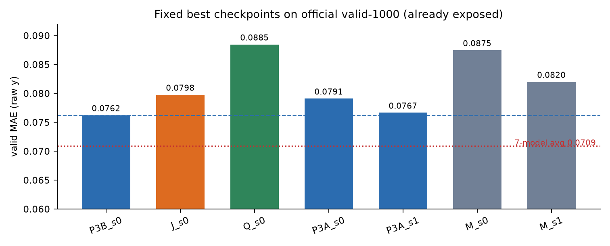
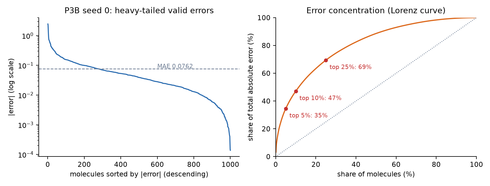
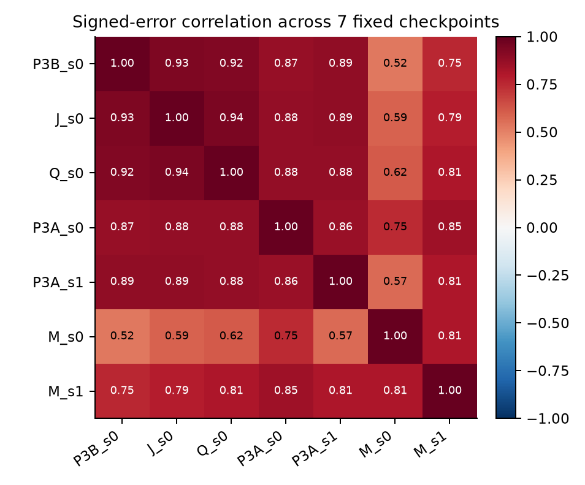
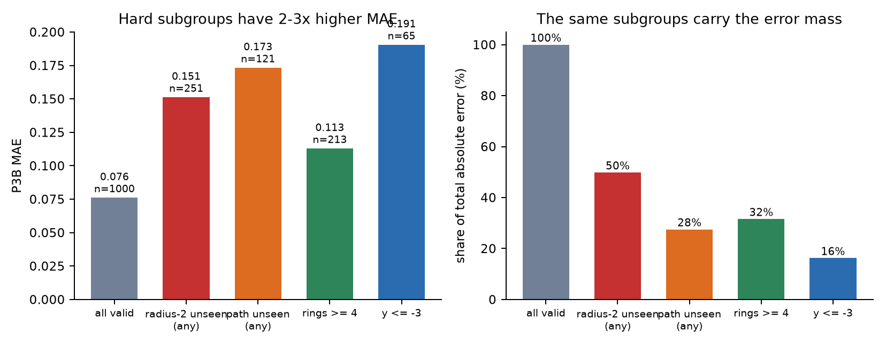

# ZINC 泛化瓶颈审计 v1 — 报告

**Track:** `tracks/structural-sufficiency/zinc_generalization_audit_v1/`
**起点 commit:** `d53e64a`
**状态:** audit complete；**本轮 0 GPU-hour**；没有重训、没有改冻结数字、没有读取 official test。
**主数据:** official PyG ZINC subset，train 10,000 / valid 1,000；valid 是历史已暴露 development split，不是新盲测。

---

## 0. 一句话结论

0.076 的平台不是“所有分子都均匀差 0.07”，也不是 seed 抽签，而是一个**跨模型共享的重尾难例核心**：最差 25% 分子承担 **69.4%** 的绝对误差；25.1% 的分子带有训练集未见的 radius-2 局部环境，承担 **49.8%** 的绝对误差；7 个固定 checkpoint 在同一批分子上同向失败。最像的机制是 **P3 Null 分组把局部 junction 身份稀释成 `n_b × graph_mean(w)`**，而不是路径内容或标签量不足。下一轮唯一主干预是 **P3 dual-channel local/global composer**：保留 P3 全局通路，并联一个 organized 局部 composer，并用同参数、同初始化的 Null-local 对照隔离“真实 ownership”与“额外容量”。参数 **494,193**，无递归局部 MP。

---

## 1. 边界与完整性

### 1.1 本轮做了什么

- 固定 7 个已有 best checkpoint，全部只在 official valid-1000 上重放；没有训练、没有 seed 搜索、没有重选 checkpoint。
- 逐分子误差表、误差重叠/互补/ensemble 诊断、稀有结构 vs 常见结构组合、输入通路窄检查全部在 CPU 完成。
- GPU 标签量曲线**没有购买**；理由见 §5.2。
- official test 的 labels、cache、predictions 全程未读取；没有构造 `path_test.pt`，没有 terminal-test。
- 所有模型数字来自已落盘 `valid_best.npz` 与已有 `train.json`；没有覆盖任何原始 artifact。

### 1.2 输入保真检查（`analysis/input_checks.json`）

| 检查 | 结果 |
|---|---|
| official processed val 与审计 cache 的 atom type | 1000/1000 完全一致 |
| 无向边集 + 键型 | 1000/1000 完全一致 |
| labels | max abs diff **0.0** |
| graph 行唯一性 | 1000 个不同 graph sha256；无重复 |
| 7 个预测文件 row 覆盖 | 每个都是 0..999，1000 个唯一行，有限值 |
| 重算 MAE vs 存储 best valid | 7/7 绝对差 **0.0** |
| J path cache 保真（row 0/172/917 全量重枚举） | pattern key 集合、root multiplicity 全部一致 |

### 1.3 一个必须披露的修正

早期草稿曾把 **split-local pattern id** 在 train 与 valid 之间直接按整数比较，得到“valid 平均 56.3% 的路径 occurrence 质量在 train 中未见过”。这是错的：pattern id 只是每个 split 内部按内容排序的地址，不同 split 的同一 id 不是同一内容。改为按 `(length, atom bytes, pair bytes)` 的**内容 key** 映射后，正确值是：

> valid 的平均 J path unseen occurrence mass = **0.40%**，median = 0；87.9% 的分子为 0。

错误数字没有进入最终结论；本报告和 `analysis/coverage_summary.json` 全部使用修正后的 content-key 结果。旧报告/旧 artifact 未改动。

---

## 2. Observed

### 2.1 固定 7 个模型的 valid 误差

| model | family | params | valid MAE | median AE | p90 AE | p95 AE | max AE |
|---|---|---:|---:|---:|---:|---:|---:|
| **P3B_s0** | P3, recipe B | 413,505 | **0.076224** | 0.039235 | 0.155379 | 0.233004 | 2.470 |
| P3A_s1 | P3, recipe A, seed 1 | 413,505 | 0.076668 | 0.038135 | 0.152390 | 0.251016 | 2.535 |
| P3A_s0 | P3, recipe A, seed 0 | 413,505 | 0.079105 | 0.040845 | 0.169055 | 0.255842 | 3.487 |
| J_s0 | full typed rooted induced paths | 484,281 | 0.079773 | 0.044644 | 0.158149 | 0.253282 | 2.614 |
| M_s1 | global moment context trunk | 435,681 | 0.081999 | 0.043904 | 0.162551 | 0.243608 | 3.705 |
| M_s0 | global moment context trunk | 435,681 | 0.087468 | 0.044101 | 0.159995 | 0.247764 | 11.445 |
| Q_s0 | typed path sequence control | 484,281 | 0.088464 | 0.054021 | 0.165893 | 0.254184 | 2.781 |

这不是架构受控实验；recipe、SSL、初始化和 family 不同，不能把这些差值当成单一 treatment effect。它只用于回答“误差是否共享”。



### 2.2 平台是重尾，不是均匀误差

P3B：

- mean |error| = 0.0762，median = 0.0392；57.1% 的分子 AE < 0.05，80.2% < 0.10。
- top 10 分子占 15.5% 总绝对误差；top 50 占 34.6%；top 100 占 47.1%。
- **最差 25% 分子占 69.4%**，其平均 AE = 0.2117；其余 75% 平均 AE = 0.0311。
- 去掉 top 50 后 MAE = 0.0525；去掉 top 100 后 MAE = 0.0448。

所以“0.076 平台”不是 1000 个分子都卡在 0.076；大多数分子已经明显更好，平台是被少数难例拉高的。



### 2.3 误差跨模型共享

- signed-error 相关：P3B vs J **0.934**；P3B vs Q **0.923**；P3B vs P3A_s0 **0.873**；P3B vs P3A_s1 **0.886**。
- 符号一致率：P3B vs J 81.4%；P3B vs Q 75.9%；P3B vs P3A 两 seed 71.3–73.1%。
- top-100 集合重叠：J 79/100、Q 73、P3A_s0 70、P3A_s1 65、M_s0 62、M_s1 51；top-25% 集合重叠 146–181/250。没有哪个 family 提供一组独立的“可救”分子。
- P3B worst-10 的平均 AE：P3B 1.18、J 1.23、Q 1.28、P3A_s0 1.27、P3A_s1 1.13、M_s1 1.14、M_s0 1.92；除 seed 抖动外，没有模型能系统性修复这组分子。



### 2.4 Seed 分歧是第二阶

| 诊断 | 值 |
|---|---:|
| P3A seed 0 / seed 1 MAE | 0.079105 / 0.076668 |
| P3A 等权平均 MAE | **0.072211** |
| 平均 vs 最好单 seed 的 gain | **0.004456**，95% CI [0.001472, 0.007303] |
| P3A 预测分歧 mean / median | 0.0551 / 0.0370 |
| consensus MSE | 0.031687 |
| 代数 seed-variance 项 | 0.002445 |
| **seed-variance 占 consensus MSE** | **7.7%**（仅两模型代数分解，不是总体 bias/variance） |
| M seed 0 / seed 1 MAE | 0.087468 / 0.081999；spread 0.005469 |

P3 两个 seed 平均确实比最好单 seed 好约 0.0045，所以 seed 噪声不是零；但它解释不了跨 family 共享的误差排序，也不是平台主因。M 的 seed spread 更大（0.0055），进一步说明“seed 分歧”与“难例核心”是两件事。

### 2.5 Ensemble 诊断：少量误差抵消，不是主模型

| ensemble | MAE | vs 最好成员 |
|---|---:|---:|
| P3A_s0 + P3A_s1 | **0.072211** | gain 0.004456，CI [0.001472, 0.007303] |
| P3B_s0 + J_s0 | 0.075480 | gain 0.000743，CI [−0.001193, +0.002672] |
| 7 模型等权 | 0.070913 | 仅诊断，不满足“单模型 ≤500k”，不能当论文主模型 |
| M_s0 + M_s1 | 0.078068 | gain vs M_s1 0.003930，CI [−0.005307, +0.009923] |

P3B+J 的 gain 接近零且 CI 跨零：J 与 P3B 的误差几乎同一条，不能提供互补信号。P3A 两 seed 的平均有真实的小收益，但这是“同 family seed 平均”，不是新的结构机制。

### 2.6 J path 覆盖：整体几乎全覆盖，但 12% 分子例外

修正后的 content-key 统计（`analysis/coverage_summary.json`）：

- valid 平均 J path unseen occurrence mass **0.40%**；median 0；87.9% 分子为 0。
- 按长度：length 5 unseen mass 0.85%，length 4 0.36%，length 3 0.12%，length 2 0.04%。
- 按固定组：

| path unseen mass | n | P3B MAE | 该组占总 AE |
|---|---:|---:|---:|
| 0 | 879 | 0.0628 | 72.5% |
| (0, 1%] | 57 | 0.1367 | 10.5% |
| (1%, 5%] | 36 | 0.1797 | 8.5% |
| >5% | 28 | 0.2399 | 8.8% |

- 121 个“有任何 unseen path mass”的分子占 **12.1%** 行，却占 **27.5%** 绝对误差；MAE 0.1734 vs 其余 0.0628。
- 但 J 并没有在这组上更好：J 的 group MAE 分别为 0.0654 / 0.1483 / 0.1985 / 0.2379；除最极端的 >5% 组外都更差。J 的 exact path content 不是可用杠杆。
- `f20_mass`（被 ≥20 个 train 分子支持的路径质量）与 AE 的 Spearman 为 **−0.252**（partial −0.228）；低支持质量与 AE 正相关（lowfreq 1–4 mass Spearman +0.247，partial +0.207）。方向是“稀有支持→更差”，但整体相关性被大量零值压住，组阈值更能说明问题。

### 2.7 Radius-2 局部环境：最强、最可操作的信号

按训练集独立分子统计精确的 typed radius-2 签名（中心原子 + 邻居键型/原子类型 + 二阶邻居）：

- 平均 **2.46%** 的 valid 原子有 train 中未见的 radius-2 签名；median 0。
- **251/1000（25.1%）** 分子至少有一个 unseen radius-2 原子。
- 这 251 个分子：P3B MAE **0.1513**；其余 749 个：**0.0511**。
- 这 251 个分子占总绝对误差 **49.8%**。
- 分层后仍成立：在每个 size quartile 内，unseen 组都更差；Spearman(unseen atom fraction, AE) = **0.314**，控制 n_atoms + cycle_rank 后 partial = **0.301**。
- 低支持但已见的 radius-2 签名（train 1–4 个分子）与 AE 的 Spearman 只有 0.236，且 366 个“low4 但无 unseen”的分子 MAE 0.0616；**unseen 本身**比“低频但已见”更强。
- radius-1 几乎全见（平均 unseen atom fraction 0.08%），不能解释误差。

| radius-2 group | n | P3B MAE | 组内总 AE 占比 |
|---|---:|---:|---:|
| 0 unseen atoms | 749 | 0.0511 | 50.2% |
| any unseen | 251 | 0.1513 | **49.8%** |
| >5% unseen atoms | 175 | 0.1752 | 40.2% |
| >10% unseen atoms | 82 | 0.2716 | 29.2% |



### 2.8 Ring 复杂度与 radius-2 novelty 的交互

- `n_rings >= 4`：213 个分子（21.3%），MAE 0.1130，占总 AE **31.6%**。
- `n_rings >= 4 且 radius-2 unseen`：47 个分子（4.7%），MAE **0.3141**，占总 AE **19.4%**。
- `n_rings >= 4 且 radius-2 全见`：166 个分子，MAE 0.0561，和普通分子差不多。
- `max_ring_size >= 8`：6 个分子，MAE 0.739；其中 4 个 radius-2 全见也仍有 0.446（n=4，不稳定，只作为 macrocycle 个案）。
- 这说明“环多”本身不是问题；“环多 + 局部环境未见”才是 hard core。

### 2.9 目标尾部是次要因素

- `y <= -3`：65 个分子（6.5%），MAE 0.1905，占总 AE **16.2%**。
- 但 radius-2 效应在 ordinary region 仍存在：
  - `y > -3 & radius-2 全见`：710 个，MAE 0.0475；
  - `y > -3 & radius-2 unseen`：225 个，MAE 0.1339。
- `y <= -3 & radius-2 unseen`：26 个，MAE 0.3019；`y <= -3 & 全见`：39 个，MAE 0.1163。
- 所以尾部标签放大了误差，但不是 hard core 的唯一来源。

### 2.10 最多 10 个跨模型共同高误差分子

`analysis/top_cases.json` 按 7 模型 AE 中位数选 top-10；10/10 都是所有模型同向误差。摘要：

| row | y | atoms | rings | max ring | cycle rank | median AE all7 | radius-2 unseen atom frac | path unseen mass |
|---:|---:|---:|---:|---:|---:|---:|---:|---:|
| 917 | −0.997 | 35 | 6 | 6 | 6 | 2.386 | 0.286 | 0.607 |
| 172 | −20.340 | 24 | 3 | 12 | 3 | 2.361 | 0.000 | 0.701 |
| 753 | −9.188 | 25 | 5 | 8 | 5 | 2.260 | 0.120 | 0.605 |
| 659 | −0.060 | 30 | 4 | 6 | 4 | 1.131 | 0.167 | 0.519 |
| 260 | −1.854 | 25 | 4 | 6 | 4 | 0.876 | 0.120 | 0.531 |
| 31 | −1.634 | 26 | 4 | 6 | 4 | 0.793 | 0.192 | 0.493 |
| 447 | −2.161 | 18 | 1 | 6 | 1 | 0.709 | 0.333 | 0.395 |
| 224 | −4.962 | 21 | 4 | 7 | 4 | 0.674 | 0.048 | 0.485 |
| 678 | −0.691 | 21 | 3 | 6 | 3 | 0.615 | 0.048 | 0.579 |
| 375 | −0.026 | 20 | 3 | 6 | 3 | 0.533 | 0.250 | 0.607 |

两种典型：

- **917**：35 atoms、6 rings、C25O5N1，所有模型预测约 −3.4，真值 −1.0；典型的 ring-rich + radius-2 unseen。
- **172**：24 atoms、12 元环、y=−20.34；P3 预测 −18.78（AE 1.56），M_s0 预测 −8.90（AE 11.44）——极端 macrocycle/尾部个案，不能用一个模型的好坏概括。

---

## 3. Interpretation

### 3.1 H1：seed 分歧是主因？——否，第二阶

支持 seed 有影响的证据：P3A 两 seed 平均比最好单 seed 好 0.00446，且 CI 不含零；M seed spread 0.0055。

反对它作为主因的证据：

1. 7 个模型的 signed error 相关 0.52–0.93，误差排序共享；不同 family 不会同时“seed 抽签抽坏”。
2. seed 代数方差只占 consensus MSE 7.7%；即使完美消掉 seed 方差，P3A consensus 仍 0.0722，远高于 0.05。
3. P3B worst-10 在所有 family 上都高误差；seed 平均不能改变 hard-core 成员。
4. top 25% 分子贡献 69.4% 误差，这个集中度不是 seed 平均能解释的。

结论：seed 是噪声层，不是平台结构。

### 3.2 H2：样本量/结构覆盖不足？——作为主因被拒绝

支持覆盖不足的表面证据：radius-2 unseen 组 MAE 0.151；path unseen 组 0.173；低频路径质量与 AE 正相关。

反对它作为主因的证据：

1. J 的 exact typed path content 覆盖了 **99.6%** 的 valid path occurrence（平均 unseen mass 0.40%），但 J 的 valid MAE 比 P3B 差 +0.00355，且在 path-unseen 组也更差。
2. radius-2 签名按 unique type 也覆盖了约 97.2%；unseen 只占 2.46% 原子。不是“没有标签”，而是“少量组合/环境没有支持”。
3. 10k train / 1k valid 的标签分布与 y 分布几乎一致（train `frac(y<-3)=7.2%` vs valid 6.5%）；不是分布偏移。
4. 如果瓶颈是全局标签量，J 增加内容后应该改善，至少不该在它最该帮助的 path-unseen 组更差；实际相反。

更准确的表述：**不是 global sample size，而是 rare local support/composition**。这也解释了为什么“再买 3k/6k 标签曲线”不划算：它只能测全局斜率，不能告诉我们局部 ownership/readout 是否用得上。

### 3.3 H3：局部 junction 身份被 Null 分组稀释？——最支持

P3 的 `group_to_bonds(NULL)`：

```
W_b = n_b * mean_G(w)
V_b = n_b * mean_G(w^2)
```

只有 `n_b` 是局部的；`w` 的 junction 内容是全图均值。对任意键，局部 junction 身份被替换成同一个图级向量，只保留“碰到的 junction 数”。这正好对应：

- 误差集中在 radius-2 unseen / ring-rich 的局部环境（25% 分子、50% 误差）；
- 不是所有分子都差：局部环境常见的 75% 分子 MAE 只有 0.031–0.051；
- 加“更多局部内容”本身不够：J 把 path content 加到 atom 输入，但仍然经过 P3 Null composer/reader，且 branch 是 zero-init/容量大；J 更差说明“内容注入位置/接口”不对，不是“局部信息无用”；
- M/S 全干替换丢掉了 P3 的 count-modulated global moments，结果更差；旧 bond composer 只在 per-bond `c_e` 上加分支，B2 只有 +0.0018 Monitor，低于 0.003 线；旧 bond-relation bridge 的门控几乎为 0；ESR 的 per-type exact residual 过拟合，+0.015–0.031 更差。

因此最像的机制不是“P3 看不到局部内容”，而是 **P3 的全局池化接口把局部内容稀释了，而现有修补要么只加内容、要么丢掉全局通路**。这直接指向 **dual-channel**：保留全局 P3 通路，同时把 organized 局部内容作为独立 reader 通道，并用同参数 Null-local 对照隔离 ownership。

这是接口层面的当前最佳解释，不是已证明的因果结论。直接用冻结 P3B 权重把 Null 换成 organized，valid MAE 会从 0.0762 坏到 0.1213（`analysis/grouping_probe.json`），说明“未训练的替换”不可行；dual-channel 是对“并联且保留全局通路”这一版本的直接检验。

### 3.4 H4：目标尾部/标签公式？——次要，不是主因

`y<=-3` 只占 6.5% 行但占 16.2% 误差；极端值（172 的 −20.34）会放大个别模型（M_s0 的 11.44）。但：

- radius-2 效应在 `y>-3` 内仍为 0.134 vs 0.048；
- top-10 共同高误差里有 917（y≈−1.0）、659（y≈−0.06）这种非尾部分子；
- 因此尾部是放大器，不是 hard core 的定义。

### 3.5 平台到底像什么

**像“共享的、重尾的局部环境组合难例”**，不是：

- 广泛均匀误差：75% 分子平均 AE 0.031，57% 分子 AE<0.05；
- 少数离群点：top 1 只占 3.2%，top 10 占 15.5%，需要 top 25% 才到 69.4%；
- seed 分歧：seed 只解释 7.7% MSE，跨 family 误差相关 0.9；
- 全局标签不足：J exact content 覆盖 99.6% 仍不改善。

一句话：**“局部环境支持不足 + 全局池化读不出局部身份”**，而不是“数据不够”或“模型太小”。

---

## 4. Decision

### 4.1 不购买 GPU 标签量曲线

`analysis/label_curve_decision.json`：

- 估算 3k/6k P3B 两跑 ≈ **0.30 GPU-h**；
- 但 J 的 exact path content 已覆盖 99.6% valid occurrence，且 J 在 path-unseen 组更差；
- 3k/6k 曲线只能给全局斜率，不能区分“标签量”与“readout/ownership”；
- 当前硬 cap 0.8594 A100-h；0.30h 会挤掉唯一 matched two-arm 干预；
- **本轮 skip**。重考虑条件：未来某个臂在 rare subgroup 出现正效应、但总体被稀释；那时曲线才有诊断价值。

### 4.2 不再做的

- 不再扫 radius/路径长度/pooling/宽度/seed；不再重开 M/S/T；不再做 exact per-type residual；不再做 bond-relation 门控；不再用等权 ensemble 当主模型。
- 不把 J/Q、M/S、bond composer、ESR、organized 单臂的旧结果重新包装成“新发现”。本报告的引用只用于界定“哪些接口已经试过”。

### 4.3 唯一主干预：P3 dual-channel local/global composer

**假设：** 如果 P3 的误差主要来自 Null 分组丢失局部 junction 身份，那么保留 P3 全局通路、并联一个 organized 局部通路，并让 reader 同时看到局部一阶/二阶矩，应该在**不损害普通分子**的前提下降低 rare-environment 分子的误差。

**结构（`code/proto_dual_channel.py` 已做 CPU 尺寸/初值检查）：**

```
P3 base: encoders -> Null composer -> c_glob
local:   encoders -> organized composer -> c_loc
         W_loc_b = Σ_{j∋b} w_j
         V_loc_b = Σ_{j∋b} w_j²
reader_in = [Σ c_glob, Σ a, Σ a², g, Σ c_loc, Σ c_loc²]
```

- 原 P3 Null 通路完全保留；局部通路是并联，不替换。
- `local_composer = MLP(296 -> 80 -> 96)`；`reader` 输入从 321 扩到 513。
- 新 reader 列零初始化；局部 composer 标准初始化但初始被零 reader 列屏蔽；初始输出与 P3B 的 max abs diff 在 CPU 上 **≤1e-7**（float32 累加顺序差异；gate 用 ≤1e-6）。
- 参数：**494,193**（P3 413,505 + local composer 31,536 + reader delta 49,152），cap 500,000，headroom **5,807**。
- 无递归局部 MP；局部 composer 只做一次 per-bond 前向，不做迭代消息传递。

**对照（必须同时跑）：**

- `C`：完全相同的参数、初始化、局部 composer 和 reader 扩展，但局部 composer 的 `W/V` 用 **Null grouping**（`n_b × graph_mean`）。
- `L`：局部 composer 用 **organized grouping**（真实 `Σ_{j∋b} w_j`）。
- `L − C` 才是 ownership 效应；`L − P3B` 是总效应。两臂同参数、同数据顺序、同 seed、同 recipe，只差局部 grouping。

**为什么这不是旧 O 的重包装：**

| 旧实验 | 与本干预的区别 |
|---|---|
| organized O 单臂（`structural_relation_composer_v1`） | O 替换 Null 全局通路；本干预保留 Null，只并联局部通道。旧 O 在 monitor/locked 小正、official valid +0.005 更差，方向不稳定；本干预用 matched Null-local 对照。 |
| J（`zinc_induced_pattern_pilot_v1`） | J 把 path content 加到 atom 输入，仍走 Null composer/reader；本干预在 composer 层给局部 ownership 一条独立 reader 通路。 |
| bond composer B2 | B2 改 per-bond `c_e` 分支，仍用 Null composer；本干预改的是 junction→bond grouping 的通道分解。 |
| ESR | ESR 是 per-type additive residual lookup；本干预是 fixed aggregation + shared composer，无 type table、无 output residual。 |
| M/S | M/S 是完整 trunk 替换，丢掉 P3 的 count-modulated global moments；本干预保留 P3。 |

### 4.4 预注册 gate（下一轮）

单 seed（seed 0）两臂并行，recipe B，600 epochs，P3B 同 recipe/SSL/数据顺序：

1. **主 gate：** `L − P3B ≤ −0.003`（L 至少好 0.003 MAE）**且** `L − C ≤ −0.002`（ownership 至少好 0.002）。
2. **安全性：** ordinary `y > -3` 不得比 P3B 差超过 0.002；top-100 误差份额不得增加超过 0.02。
3. **描述性：** radius-2 unseen 组、path unseen 组、ring≥4 组的 MAE 方向；不作为主要选择依据。
4. **停止：** 单 seed；gate 失败即关闭，不买 seed 1，不扫 local width/reader 宽度/grouping 变体。
5. **预算：** 两臂 × 600 epochs ≈ 0.66h；timing/smoke 0.03h；计划 0.69h，15% margin 0.80h，硬 cap 0.8594h。若单臂 timing 投影 >0.36h，停止不跑正式。

---

## 5. 预算与复现

### 5.1 本轮预算

| item | GPU-h |
|---|---:|
| 审计（CPU only） | **0.0** |
| 训练/重放/标签曲线 | **0.0** |
| ledger remaining before | 0.8594111111111111 |
| ledger remaining after | **0.8594111111111111** |

没有启动任何 GPU 任务；没有消耗预算。

### 5.2 下一轮预算

| item | GPU-h |
|---|---:|
| L seed0 600 ep | ~0.33 |
| C seed0 600 ep | ~0.33 |
| 2-epoch timing/smoke（两臂） | ~0.03 |
| **planned** | **~0.69** |
| +15% margin | ~0.80 |
| hard cap | 0.8594 |

单 seed only；seed 1 不在本轮 cap 内。若 L 通过 gate，下一轮才申请 seed 1（约 0.33h），不要在这轮偷偷加。

### 5.3 复现命令（CPU 审计）

```bash
cd /home/calendar/code/research/tracks/structural-sufficiency/zinc_generalization_audit_v1
uv run python code/audit_inputs.py
uv run python code/audit_errors.py
uv run python code/audit_coverage.py
uv run python code/audit_topcases.py
uv run python code/audit_grouping_probe.py
uv run python code/proto_dual_channel.py
uv run python code/make_figures.py
```

`audit_grouping_probe.py` 是**冻结 P3B 权重**的 Null→organized 反事实推理：organized MAE 0.1213（比 Null 差 0.0451），说明未训练的 organized 替换会破坏 P3；这支持“并联 + 保留全局通路”而不是“替换”。该探针不是训练证据。

### 5.4 文件

```text
analysis/
  model_metrics.json          7 模型 MAE/分位/top-k
  error_relations.json        signed/abs 相关、符号一致、pair 对比
  key_contrasts.json          paired bootstrap
  ensembles.json              诊断 ensemble
  seed_consensus.json         seed 代数分解
  input_checks.json           输入/预测/cache 保真
  coverage_summary.json       J path 覆盖、radius-1/2、分层
  signature_summary.json      radius 签名覆盖
  per_molecule.csv            1000 行逐分子底表
  top_cases.json              top-10 共同高误差
  grouping_probe.json         Null vs organized 冻结权重反事实
  dual_channel_prototype.json 494,193 参数/初值检查
  decision.json               机器可读决策
  label_curve_decision.json   标签曲线 skip 理由
  short_intermediate.md       短判断
  figures/                    fig1–fig4
code/
  audit_common.py
  audit_errors.py
  audit_coverage.py
  audit_inputs.py
  audit_topcases.py
  audit_grouping_probe.py
  proto_dual_channel.py
  make_figures.py
NEXT_STEP_PROMPT.txt
```

---

## 6. Observed / Interpretation / Decision（压缩版）

**Observed**

- P3B valid MAE 0.0762；top 25% 分子占 69.4% 绝对误差；7 模型共享误差排序（signed corr 0.52–0.93）。
- 25.1% 分子有 radius-2 unseen 环境，占 49.8% 绝对误差；12.1% 分子有 path unseen，占 27.5%。
- J exact path content 覆盖 99.6% occurrence，但 J 比 P3B 差 0.00355；7 模型 ensemble 只到 0.0709。
- P3 seed 平均 0.0722；seed 方差占 consensus MSE 7.7%。

**Interpretation**

- 平台是**共享重尾难例**，不是均匀误差、不是 seed 抽签、不是全局标签不足。
- 最像的机制是 **Null 分组把局部 junction 身份稀释为 `n_b × graph_mean(w)`**；J 的失败说明“只加内容”不够，M/S/ESR 的失败说明“替换/查表”也不够。
- 尾部标签（`y<=-3`）是放大器（16.2% 误差），不是 hard core 的定义。

**Decision**

- **不买** GPU 标签量曲线（0.30h，不能改变当前判断）；不扫结构特征/seed。
- **唯一主干预：** P3 dual-channel local/global composer（organized 局部通道 + 同参数 Null-local 对照），494,193 参数，无递归 MP。
- 单 seed 两臂，预注册 `L−P3B ≤ −0.003` 且 `L−C ≤ −0.002`；计划 0.69h，cap 0.8594h；失败即关闭。
