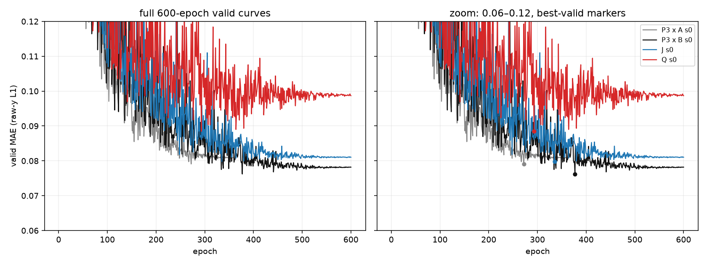

# zinc-induced-pattern-pilot-v1 — 报告

**状态：closed（性能假设未获支持）**
**协议：** `zinc-induced-pattern-pilot-v1`
**正式训练 commit：** `e24a942bee6627d1cb3dcb30fb4a9103c76a8e90`
**主参照：** P3 × recipe B seed 0 = **0.076224**（epoch 377，`zinc_recipe_trunk_v2/runs/xBssl_P3N_s0`）
**数据：** official PyG ZINC subset，train 10,000 / valid 1,000，raw-`y` L1
**Test：** 本轮从未读取。没有构造 `path_test.pt`，没有调用 terminal-test；`train.json.official_test_loaded = false`。

---

## 1. 边界与参照核对

- 只使用 valid 做决策；valid 是历史已读 split，本轮不是新的盲测。
- 不重开 M/S/T readout 调参，不追加 masked auxiliary，不做 GRIT 复现，不跑 rank/深度/路径长度/pooling/优化器网格。
- 主参照固定为 P3 × B seed 0，而不是 P3 × A 的较差 cell。P3 × A seed 0/1 仅作为历史背景列出。
- 参照审计（CPU，见 `analysis/cpu_checks.json: reference_audit`）：
  - P3 × B checkpoint `best.pt` 的 `epoch = 377`，stored valid = 0.07622375113883754；
  - 用同一 P3N 图重放 valid，得到 0.0762237378，差 1.3e-8；
  - seed-0 SSL encoder sha256 = `006fabc11efede091420fc2126ef2ef1c46cb3948ab91648a96843c0352bfa97`；
  - recipe B：AdamW，batch 128，600 epochs，79 steps/epoch，500-step warmup，per-step cosine 1e-3→1e-5，wd 1e-5，clip 5，raw-y L1；
  - train/valid label sha256 与所有 new runs 一致。

**重要纠错（保留旧数字不变）：** 旧 `zinc_recipe_trunk_v2/REPORT.md` §4.2 把 P3 的优势解释为“每条键真实所属 junction 的局部内容”。代码核对表明这是错误的。`structural_relation_composer_v1.BJOC.group_to_bonds(NULL)` 计算的是**全图** junction 均值 `mean(w)`、`mean(w²)`，再对每条键乘以该键的 junction 数 `n_b`。只有 `n_b` 是局部的，junction 内容不是局部分组。新 CPU 检查 `p3_null_grouping_semantics` 在 209 条 bond 上验证
`W = n_b * graph_mean(w)` 的最大误差为 **0.0**，而它和“把触及该键的 junction 直接求和”的最大差为 **9.7604**。旧报告已按此修正，实验数字和原决策均未改动。

## 2. 模型 J 与对照 Q

### 2.1 静态对象

对每个分子、每个根原子 `v`，枚举从 `v` 出发、长度 `l ∈ {2,3,4,5}` 条边的**全部 simple paths**。节点身份在序列内互异；根固定在位置 0；反转路径会改变根，是不同对象。没有按节点编号截断、随机采样或按 split 改数量。

每个对象保留：

- 原始 21 类 atom category（来自 raw atom type one-hot，不是 raw atom index 的数值）；
- 6 个位置的 learned position embedding（根角色由位置 0 表示）；
- 15 个无序 pair 的完整 typed induced adjacency：连续路径边 + 所有非连续额外边；`0 = no edge`，`1..3 = raw bond type`；
- 显式 node mask、pair mask、length。padding 与真实 no-edge 通过 mask 区分。

重复的 raw typed trace 压成一个内容 pattern，并保留每个 root 的真实 multiplicity；唯一 pattern 数不等于 occurrence 数。路径枚举总量：

| split | length 2 | length 3 | length 4 | length 5 | 合计 occurrence |
|---|---:|---:|---:|---:|---:|
| train | 692,716 | 880,906 | 1,104,178 | 1,294,262 | **3,970,062** |
| valid | 69,040 | 87,634 | 109,498 | 127,892 | **394,064** |

内容 pattern 数：train J 36,263 / Q 26,421；valid J 15,759 / Q 12,083。pattern id 只是按内容字节排序的可逆地址，没有 learned pattern-id embedding，也没有 OOV 表或按 valid 频率筛选。

### 2.2 共享 φ 与 root 聚合

```
input = [6 个 atom-category embedding (12d), 6 个 position embedding (4d),
         15 个 pair-type embedding (6d), 15 个 pair-position embedding (4d),
         node mask (6), pair mask (15), normalized length (1)] = 268d
φ = MLP(268 -> 80 -> 32)，所有 pattern、分子、root 共享
```

每个 root、每个长度分别计算 occurrence-weighted `mean(φ)`、`mean(φ²)`、`log1p(count)`，并带 existence mask；四个长度拼接为 264d，经共享投影 `264 -> 128 -> 96` 得到增量 `d_v`。无该长度时前三项为 0、mask 为 0；完全无路径的 root 的 `d_v` 严格为 0。投影最后一层零初始化。

```
a_v = atom_encoder(raw108_v) + d_v
```

随后重算原 P3 bond encoder、junction encoder，接原 P3 **Null** composer 和 reader；没有最终预测上的 lookup residual，没有冻结 encoder，没有 encoder LR 缩放，没有辅助 loss。

### 2.3 参数量（CPU 审计，正式 run 前）

| component | params |
|---|---:|
| P3 atom encoder | 26,336 |
| P3 bond encoder | 62,816 |
| P3 junction encoder | 112,896 |
| P3 group composer | 62,976 |
| P3 reader | 148,481 |
| **P3 subtotal** | **413,505** |
| path branch（embeddings + φ + projection） | **70,776** |
| **J total** | **484,281** |
| cap | 500,000 |
| headroom | 15,719 |

Q 使用完全相同的参数布局、初始化和 P3 接口，只把非连续 pair type 置 0。J/Q 参数均为 484,281。

### 2.4 Q 对照

Q 保留同样的 rooted path traces、multiplicities、atom labels、连续 bond labels、mask、参数布局、初始化、P3 接入和 recipe；仅把非连续位置之间的额外边替换为“无边”。J vs Q 区分“完整诱导拓扑”相对“联合 typed sequence”的价值；两者都新增了 typed sequence 能力，所以不能把 J vs Q 解释成控制了所有高阶信息。

## 3. CPU 核验（正式 GPU 前）

`analysis/cpu_checks.json`：**13/13 pass**。关键结果：

| check | 结果 |
|---|---|
| 小图枚举/多重集 | 4-cycle：length 2 = 8，length 3 = 8，length 4/5 = 0；root0 的 length-2 pattern 多重数 = 2（同类型不同节点仍是两个 occurrence） |
| 六元环 vs 链 | 环 length-5 共 12 个 oriented paths，链 2 个；J 的 `(0,5)` extra pair = 1，链 = 0；Q 两者 key 相同 |
| 整图随机重编号 | 单分子 full-model eval 预测最大差 5.96e-7；pattern 多重集/root 聚合不变 |
| 跨图 batch | 另一分子加入前后，目标分子 root `d_v` 最大差 3.73e-9，预测最大差 2.68e-7 |
| 压缩/展开同一多重集 | 586 entries 拆成 1,172 entries 后 `d_v` 最大差 1.49e-8 |
| 零增量 | J 和 Q 对同批 P3N 前向最大差 **0.0** |
| SSL / 初始状态 | 24 个 P3 张量与参照 builder 逐 tensor 相等；12 个 encoder 张量与 SSL checkpoint 相等（max diff 0.0） |
| 参数/optimizer | 484,281 参数，全部 requires_grad，optimizer 覆盖全部参数 |
| 零初始化梯度 | step 1：`proj` grad 非零、φ grad 为 0（预期）；step 2 起 φ grad 非零且有限 |
| 无路径 root | `d_v` 全 0、有限 |
| P3 Null 语义 | `W = n_b * graph_mean(w)` 最大误差 0.0；与 local junction sum 最大差 9.7604 |

这些是 CPU correctness checks，不是泛化证据；2-epoch timing 只用于成本测量。

## 4. 预算、计时与分支

- 总 cap：**1.7558 A100-hours**（两卡合计，包含 timing/smoke/正式训练）。
- Timing（J/Q 各 2 epochs，含完整 valid）：
  - J：2.758 s/epoch，projected 600 epochs = **0.4596 GPU-h**；
  - Q：2.498 s/epoch，projected 600 epochs = **0.4163 GPU-h**。
- 分支规则：两卡 600-epoch 完整 run + timing + 15% margin 是否能放进 cap。
  - `2 × full = 0.8759 h`，+15% = 1.0073 h；+ timing 0.0086 h = **1.0159 h <= 1.7558 h** → **branch a**，J 与 Q seed 0 并行。
- 正式 run 实际占用（job occupancy，两个 GPU 相加）：
  - J：08:21:52→08:46:51，1,499 s = **0.4164 GPU-h**；
  - Q：08:22:01→08:50:18，1,697 s = **0.4714 GPU-h**；
  - 正式合计 **0.8878 GPU-h**；加 timing/smoke **0.8964 GPU-h**。
- 剩余：**0.8594 GPU-h**。没有超支、没有抢占其他任务、没有压缩 horizon 或重置 cosine。
- 详细 ledger：`analysis/budget_ledger.json`；timing：`analysis/timing.json`。

## 5. 正式 valid 结果

| model | params | best valid | best epoch | train@best (eval) | final valid | final train (eval) | GPU-h |
|---|---:|---:|---:|---:|---:|---:|---:|
| P3 × A s0（历史背景） | 413,505 | 0.079105 | 272 | 0.011261 | 0.080947 | 0.002270 | 0.2008* |
| P3 × A s1（历史背景） | 413,505 | 0.076668 | 267 | 0.011949 | 0.077984 | 0.002111 | 0.2136* |
| **P3 × B s0（主参照）** | 413,505 | **0.076224** | 377 | 0.014680 | 0.078179 | 0.000820 | 0.3014* |
| **J s0** | 484,281 | **0.079773** | 335 | 0.018212 | 0.081033 | 0.000579 | 0.4133 |
| **Q s0** | 484,281 | **0.088464** | 293 | 0.037233 | 0.098693 | 0.000707 | 0.4686 |

\* P3 行是历史/前一轮成本，不在本轮 1.7558 h 内重复计费；列出仅为同 valid split 背景。J/Q 的 GPU-h 为本轮实际 run-level cost。

### 5.1 原始曲线



曲线由 trainer 每 epoch 写出，无平滑或重构；原始数值见 `runs/J_s0/curve.csv`、`runs/Q_s0/curve.csv`，以及主表引用的 P3 curves。J 的 best 在 epoch 335，之后 valid 缓慢变差、final train@eval 降到 0.000579；Q best 在 293，final valid 0.098693。两者都没有出现“训练尚下降所以应延长”的合法理由：600-epoch cosine 已完整跑完，best 和 final 均已记录。

### 5.2 配对 bootstrap（valid 1,000 molecules，10,000 resamples）

负值 = 前一个模型更好。

| contrast | mean Δ valid MAE | 95% CI |
|---|---:|---:|
| J s0 − P3 × B s0 | **+0.003550** | [+0.000127, +0.007067] |
| Q s0 − P3 × B s0 | **+0.012240** | [+0.008626, +0.015971] |
| J s0 − Q s0 | **−0.008690** | [−0.012140, −0.005257] |
| J s0 − P3 × A s0 | +0.000669 | [−0.004707, +0.005707] |
| Q s0 − P3 × A s0 | +0.009359 | [+0.004237, +0.014224] |
| J s0 − P3 × A s1 | +0.003106 | [−0.001425, +0.007680] |
| Q s0 − P3 × A s1 | +0.011796 | [+0.007315, +0.016342] |

这是同一 valid split 上的描述性 paired interval；valid 已被历史多轮使用，不能当作新的盲测，也不是训练 seed 显著性检验。

## 6. Observed / Interpretation / Next choice

### Observed

- J seed 0：best-valid **0.079773 @335**，final 0.081033；484,281 params；实际 0.4164 GPU-h occupancy。
- Q seed 0：best-valid **0.088464 @293**，final 0.098693；484,281 params；实际 0.4714 GPU-h occupancy。
- 主参照 P3 × B s0：**0.076224 @377**。J 比它差 **+0.003550**，Q 差 **+0.012240**。
- J 与 P3 × A s0 几乎持平（+0.000669，CI 跨零）；J 对 Q 有 **−0.008690** 的优势（CI 不含零）。
- 全部 run 完整 600 epochs，79 steps/epoch；`official_test_loaded = false`；没有 test predictions。
- 13/13 CPU checks 通过；正式训练无非有限值；J/Q 的 checkpoint/curve/valid predictions 均已落盘并计算 sha256。

### Interpretation

- 在这个固定表示、P3 接口和 recipe B 下，**J 没有改善当前 P3 × B 的泛化**；它的 valid 甚至比主参照差约 0.00355。单 seed、valid 历史复用，不能做 SOTA 或显著性宣称；但“没有清晰正信号”是明确的。
- Q 明显更差，说明去掉非连续诱导边、只保留 typed path sequence 不足以支撑这个接口。J 相对 Q 的 +0.00869 是“完整诱导拓扑相对 typed sequence 有价值”的性能信号，但两者都仍落后 P3；这不能升级成机制结论，也不能解释为“所有高阶信息已被控制”。
- J 的 train@best eval = 0.0182，final train = 0.000579，而 valid 从 0.0798 退化到 0.0810；Q 同样在 best 后明显过拟合（final valid 0.0987）。可以合理怀疑新增路径容量在这个 readout/接口下更多是拟合训练集，而不是改善泛化；但这只是解释，不是通过额外实验确认的机制。
- 负结果的范围仅限：**这组 rooted simple-path 对象、完整诱导 pair 内容、共享 φ、root-length moment 聚合、提前接入 P3 编码链、recipe B、单 seed**。不能写成“高阶模式无用”“无法突破 0.07”。

### Next choice

- **停止本 pilot。** J/Q 均无对 P3 × B 的清晰 valid 增益；不购买 seed 1，不补 P3 × B seed 1，不打开 rank/深度/路径长度/pooling/aux/optimizer/recipe 网格，也不回头重跑 P0/P1 挽救故事。
- 若未来还要问“高阶结构是否值得”，需要新的 pre-registration 和不同的对象/接口（例如不同的组合位置或不同的池化接口），而不是在本轮结果上做窗口搜索。
- 本轮不读取官方 test；不发布论文结论，不发导师消息，不推外部服务。
- 剩余 0.8594 GPU-h 保留，不擅自追加或消耗。

## 7. 成本、产物与复现

### 7.1 成本

| item | GPU-h |
|---|---:|
| J/Q 2-epoch timing + failed launch | 0.0086 |
| J seed 0 600 epochs | 0.4164 |
| Q seed 0 600 epochs | 0.4714 |
| **total conservative** | **0.8964** |
| cap | 1.7558 |
| remaining | 0.8594 |

CPU 枚举/缓存/检查不计 A100 费用；`ip_data.py prep` 在 `res` CPU 上约 31 s。

### 7.2 机器可读产物

- `analysis/main_table.json` / `main_table.md` — 所有模型行、best/final、GPU-h、sha256。
- `analysis/paired_bootstrap.json` — 上述 paired contrasts。
- `analysis/round_decision.json` — 机器可读 Observed / Interpretation / Next choice。
- `analysis/cpu_checks.json` — 13 项 CPU checks 与参照审计。
- `analysis/timing.json` — 2-epoch timing。
- `analysis/budget_ledger.json` — 预算分支与 actual spend。
- `analysis/artifact_hashes.json` — J/Q/P3-B checkpoint、curve、valid predictions 的 sha256。
- `configs/induced_pattern_pilot_v1.yaml` — 冻结配置。
- `runs/J_s0/`、`runs/Q_s0/` — `best.pt`、`final.pt`、`curve.csv`、`train.json`、`predictions/valid_best.npz`、`artifacts.json`（大 artifact 按 `.gitignore` 忽略）。

### 7.3 Checkpoint hashes（完整值见 `analysis/artifact_hashes.json`）

| model | best.pt sha256 | final.pt sha256 |
|---|---|---|
| J s0 | `4b911f374c3d47757ec6230b73120d2ce5bf6bc89d798eb40f8db6462117bca4` | `c5567cf2e718ae60b79e284ebee59fef431bc66a4c7ece5c814b625966a50a43` |
| Q s0 | `f53fcbfa4245728c1a74f02210201c11390dea948d4fcf8805fcc03f42b71271` | `347aa6c840ed5df88c86461e33e09b6a4191721d31c26ce43205b5dfbf40a4ca` |
| P3 × B s0（参照） | `4c379c93214c003a6c58fd4add4a64ecb4fe23603233738fab18f3885abdc34f` | `c9c08eb80e4ef5eb0fb75c3603602b7fce05f051a12f409835e812ce15fa7f27` |

### 7.4 复现命令

```bash
cd tracks/structural-sufficiency/zinc_induced_pattern_pilot_v1/code

# 1) CPU: 枚举缓存 + 检查（train/valid only；不构造 test）
uv run python ip_data.py prep
uv run python ip_cpu_checks.py
uv run pytest -q tests/test_ip_cpu.py

# 2) 2-epoch timing（GPU；非正式训练）
uv run python ip_runner.py timing --candidates J,Q --epochs 2 --device cuda:0

# 3) 正式 J/Q seed 0，recipe B（两卡各一个进程）
uv run python ip_runner.py train --candidate J --seed 0 --recipe B --device cuda:0
uv run python ip_runner.py train --candidate Q --seed 0 --recipe B --device cuda:1

# 4) 汇总（只读 valid）
uv run python ip_report.py
```

远端等价入口（通过 `rr`，不可手工 nohup）：

```bash
rr deploy res
rr run res zip-J-s0 --pool res-gpu0 --gpus 1 --time 1:30:00 -- \
  python tracks/structural-sufficiency/zinc_induced_pattern_pilot_v1/code/ip_runner.py \
  train --candidate J --seed 0 --recipe B --device cuda:0
rr run res zip-Q-s0 --pool res-gpu1 --gpus 1 --time 1:30:00 -- \
  python tracks/structural-sufficiency/zinc_induced_pattern_pilot_v1/code/ip_runner.py \
  train --candidate Q --seed 0 --recipe B --device cuda:0
```

实际远端 run id：J `zip-J-s0-20261021-082150-c123f1ff`，Q `zip-Q-s0-20261021-082159-2e070750`；远端目录名因 `--tag J/Q` 为 `J_J_s0` / `Q_Q_s0`，本地分析副本重命名为 `J_s0` / `Q_s0`（内容与 sha256 未变）。
