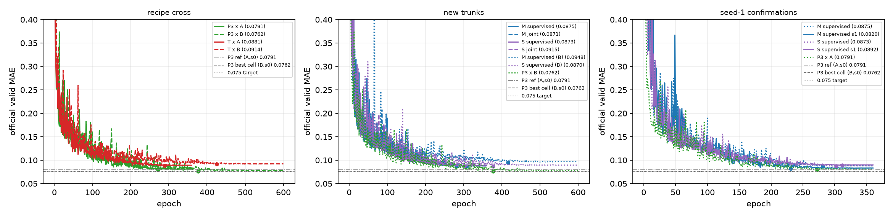

# zinc-recipe-trunk-v2 — round report

**Status:** closed. Two declared questions were answered on the official valid
split: (i) the v1 architecture comparison was confounded with the training
recipe, and the confounding is now measured; (ii) two rebuilt composition
trunks (global moment context, learned context slots) come within ~0.003-0.010
of P3 but **none beats P3**, and the 0.075 development target is not reached.
The official test split was **not read at all** in this round.

Reference throughout: P3 seed 0 best-valid = **0.079105** (seed 1 = 0.076668),
same valid split, historical run reused without retraining or rebilling. The
curve value is 0.07910466; the 8.4e-7 difference from the 0.0791054978 stored in
`ad_common` is a float32 regression-log artefact and changes no delta at 6
decimals, so the P3 row below shows Δ = 0.000000.

## 1. Boundary

- Data and selection: official PyG ZINC subset, train 10,000 / valid 1,000,
  raw-`y` L1, full valid every epoch, best checkpoint by strict `<` (earlier
  epoch on a tie). Test is never constructed in this round; no reported number
  below comes from test.
- Parameter cap: every model <= 500,000 trainable parameters including SSL
  encoders and auxiliary heads. All audited counts are in the tables.
- No local recursive message passing, no new raw-structure vocabulary, no VQ,
  no path-bank changes, no full GRIT.
- Reused unchanged: the v1 data cache, the v1 collate/trainer/best-valid
  evaluation, and the frozen P3 train-only masked-SSL encoders (loaded and
  fine-tuned; never frozen, never given a lower LR).
- Code: `code/` in this directory plus a small additive patch to
  `zinc_arch_discovery_v1/code/ad_train.py` (named recipe variants, optional
  model builder / output dir / auxiliary loss) and to
  `ad_models.py` (`path_token_scalars`, see §2). No v1 result, checkpoint or
  report text was modified.

## 2. Phase 0 — cheap CPU facts (no GPU)

### 2.1 `closes` in the sampled-walk features was mis-defined

v1 computed `closes = (wa == wa[:, :1]) & (pos > 0) & valid`, i.e. "the current
atom **type** equals the start atom type". That is not return-to-start. It is
now `closes = (wanon == 0) & (pos > 0) & valid` (anonymous pattern index 0,
excluding the start token and padding), factored into
`ad_models.path_token_scalars`. Two 3-token walks, which differ only in whether
the third token revisits the start atom:

| walk | old flags | corrected flags |
|---|---|---|
| propane `0-1-2` (three distinct atoms, same element) | `F T T` | `F F F` |
| ethane `0-1-0` (one genuine return) | `F T T` | `F F T` |

Anonymous-mode tokens still carry identity structure, so this is **not** offered
as an explanation of the whole v1 P0/P1 gap (−0.32). The old P0/P1 runs are kept
as reported and were not retrained or renamed.

### 2.2 Corrected P0/P1 readout: 32 vs 128 walks, and repetition invariance

Same 8 valid molecules; train-style 32-walk sample vs the fixed 128-walk bank;
"repeat" duplicates every sampled token in the batch (the readout must not move).

| model | checkpoint | mean abs prediction shift 32→128 | repeat-token max abs diff | MAE on these 8 rows (32 / 128) |
|---|---|---:|---:|---|
| P0 corrected | `corr_P0_s0/best.pt` @203 | 0.100 | 2.4e-7 | 0.277 / 0.249 |
| P1 corrected | `corr_P1_s0/best.pt` @312 | 0.077 | 4.8e-7 | 0.240 / 0.271 |

The old split-scale blow-up (0.338 @32 walks vs 0.691 @128 walks) is gone; what
remains is sampling noise at the level of a few hundredths, not a reader scale
collapse. This did not trigger any GPU rerun.

### 2.3 The recipe cross compares recipes, not a reimplementation

`P3NullModel` reimplements P3's graph (encoders -> Null composer -> 321-d
reader) in the v1 batch layout; a `BJOC` state dict loads into it after a key
remap. Loading the frozen `zpp` P3 seed-0 best checkpoint (epoch 272) into both
and scoring 16 valid molecules gives **max |difference| = 0.0**, both
413,505 parameters. (`analysis/cpu_checks.json`.)

## 3. Phase I — architecture x recipe 2x2

| | recipe A (Adam, 360 ep, no warm-up) | recipe B (AdamW, 600 ep, 500-step warm-up) |
|---|---|---|
| **P3** | 0.079105 @272 *(existing, not rerun)* | **0.093734 @464** *(new, 0.343 h)* |
| **T (rank 16)** | **0.088070 @289** *(new, 0.206 h)* | 0.091375 @426 *(existing, not rerun)* |

Both new cells: seed 0, seed-0 train-only SSL initialisation, same cache /
shuffle seed / collate / selector / valid evaluation. Only the named recipe dict
differs. Recipe A = Adam, batch 128, 360 epochs, no warm-up, per-step cosine
1e-3 -> 1e-5, wd 1e-5, clip 5. Recipe B = AdamW, batch 128, 600 epochs,
500-step warm-up, per-step cosine 1e-3 -> 1e-5, wd 1e-5, clip 5. Declared
deviation: the v1 trainer applies the step-`k` learning rate to update `k`,
whereas `zpp_p3` used `k-1` (one step out of 28,440).

Measured, not inferred:

| contrast | value |
|---|---:|
| P3: B − A | **+0.014630** (B clearly worse) |
| T: A − B | **−0.003305** (A better, below the pre-declared 0.005 "clear" bar) |
| gap under A: P3 − T | **−0.008965** (P3 better) |
| gap under B: T − P3 | **−0.002359** (T slightly better) |

**Observed.** P3 loses ~0.015 valid under T's v1 recipe; T loses ~0.003 under
P3's recipe. Neither architecture was trained at its best cell under the other's
recipe: under recipe B, T is nominally 0.002 *better* than P3, and under recipe
A, P3 is 0.009 better than T.

**Interpreted (not more than the data supports).** The v1 statement "T is
0.0123 behind P3" was measured across two different recipes and therefore mixes
a recipe effect with an architecture effect. Lower is better, so the honest
common-recipe statements are: under recipe A, P3 is 0.0090 lower than T; under
recipe B, T is 0.0024 lower than P3. Recipe B is not a neutral control: it
clearly degrades P3, the architecture it was not tuned for. This compares recipes as wholes; it does **not** separate optimizer,
epochs and warm-up, and it does not identify the new trunks' recipe (that was
fixed separately, §4).

**Consequences applied.** The pre-declared rule "T improves clearly if >= 0.005"
was not met (0.0033), so Phase II was not reduced and no T seed-1 was bought;
Phase II's optimizer rule ("Adam unless P3-B beats P3-A by >= 0.002") selected
Adam, because P3-B is worse, not better.

## 4. Phase II — four seed-0 trunk candidates (+ two seed-1 confirmations)

Shared: P3 atom/bond/junction raw objects and P3-compatible encoders
(108->128->96, 295->160->96, 608->160->96), seed-0 train-only masked-SSL initial
weights, normal fine-tuning. Typed local embeddings (96) + per-type embedding,
`global33`, explicit per-type counts. Global context only; no local hidden-state
update; no association tensor; no P3 prediction shortcut.

- **M**: one global moment context
  `c_G = ContextMLP([sum h, mean h^2, log1p N]_type, global33)` (612->128->64),
  then per object `u_o = t_o + Phi([t_o, c, t_o*W c])` with a shared
  `Phi` (256->128->96) and `t_o = h_o + type_embedding`; typed readout
  `[sum u, mean u^2, log1p N] + global33` -> reader (612->128->128->1).
- **S**: same object set/tokens and the same `Phi`; instead of one moment
  vector, `K=8` learned queries cross-attend all objects of the molecule
  (4 heads, d=96, pre-LN + FFN), each object cross-attends the 8 slots to get
  its own context (projected to 64), then the same `Phi`/readout. Attention is
  molecule-masked: perturbing one molecule leaves the others bitwise unchanged
  (measured 0.0); batch-vs-single difference ~1e-6.
- **joint** variants add `0.05 * (mean CE_atom + mean CE_bond)` on a masked view
  of the same molecules, using the frozen P3 mask construction (15% atoms /
  15% bonds, mask tokens, full feature rebuild, hidden raw codes as targets,
  28/4 classes). `lambda = 0.05` was recorded before the first joint run; no
  grid, no balancing. Clean branch predicts `y` only. Linear CE heads are
  counted in the parameter totals.

Trunk recipe (variant C, fixed before the first M/S run, identical for both
architectures and both training modes): Adam, batch 128, **360 epochs**,
500-step warm-up, per-step cosine 1e-3 -> 1e-5, wd 1e-5, clip 5. A 2-epoch
timing job measured 2.99 s/epoch (M), 3.35 (S) and 3.59 (M joint before the
formal run), so the declared horizon was ~0.25-0.36 A100-h per supervised run;
the formal runs came in at 2.45-3.80 s/epoch. The horizon was not compressed;
the latest best epoch is 324/360 and every run's final valid is within 0.002 of
its best, so no run was cut off at the boundary.

| run | params | best-valid | best ep | train@best (eval) | Δ vs P3 s0 | s/epoch | GPU-h |
|---|---:|---:|---:|---:|---:|---:|---:|
| M supervised s0 | 435,681 | 0.087468 | 281 | 0.010860 | +0.0084 | 2.52 | 0.252 |
| M joint s0 | 448,385 | 0.087086 | 308 | 0.007591 | +0.0080 | 3.30 | 0.331 |
| S supervised s0 | 468,161 | 0.087267 | 302 | 0.008844 | +0.0082 | 3.80 | 0.381 |
| S joint s0 | 480,865 | 0.091514 | 324 | 0.005574 | +0.0124 | 4.63 | 0.464 |
| M supervised s1 | 435,681 | **0.081999** | 231 | 0.020363 | +0.0029 | 2.45 | 0.246 |
| S supervised s1 | 468,161 | 0.089212 | 312 | 0.006726 | +0.0101 | 3.54 | 0.355 |

Δ is best-valid minus the P3 seed-0 best-valid, quoted to 1e-4 because the seed
spread of these families is 2-5e-3; exact values are in
`analysis/main_table.json`.

Seed comparison (best-valid, same split):

| family | seed 0 | seed 1 | seed mean | spread | Δ mean vs P3 mean |
|---|---:|---:|---:|---:|---:|
| P3 | 0.079105 | 0.076668 | **0.077886** | 0.002437 | — |
| M supervised | 0.087468 | 0.081999 | **0.084734** | 0.005469 | +0.0068 |
| S supervised | 0.087267 | 0.089212 | **0.088239** | 0.001945 | +0.0104 |
| T (rank 16, recipe A) | 0.088070 | not run | — | — | — |

Auxiliary-task diagnostics (`analysis/aux_*.json`, `runs/*/aux_curve.json`):

- Joint − supervised: **M −0.000382** (noise), **S +0.004247** (clearly worse).
- The masked branch's CE falls to 0.154 nats (atom) and 0.012 (bond), i.e. below
  the frozen SSL pretraining's final 0.213 / 0.019, while fitting 4 fixed mask
  snapshots instead of a fresh mask per visit. A large part of the auxiliary
  signal is therefore memorisation of the fixed masks, not a stronger
  representation; the joint training also reaches lower train@best (S joint
  0.0056 vs S supervised 0.0088) while valid gets worse.

**Observed.** The best new-model cell is M supervised seed 1 (0.081999), 0.0029
behind P3 seed 0 and 0.0053 behind P3 seed 1. No trunk beats P3 at either seed
and none reaches 0.075. M's seed spread (0.0055) is larger than P3's (0.0024),
so the 2-seed M−P3 mean gap (+0.0068) is suggestive but not resolved; S is
consistent across seeds and clearly behind (+0.0104). The masked auxiliary task
is not a reliable regulariser here: neutral for M, harmful for S.

**Interpreted.** Both trunks are far better than every non-T v1 family
(0.134-0.165) and land in T's range with fewer parameters, which supports the
"per-object composition over typed objects" direction. They still do not beat
P3, whose composer differs in one respect that the new trunks deliberately do
not have: it composes each bond from its **local incidence** (the junctions that
actually touch that bond) before pooling, whereas M/S give each object only a
**whole-graph** context. This round cannot tell whether that local-ownership
term or the 1-object-type (bond-centric) readout is what P3 still has.

## 5. True curves



Measured official-valid curves, logged by the trainer (no smoothing or
reconstruction). Markers are the selected best-valid epoch. The horizontal
dash-dot line is the P3 seed-0 reference (0.079105); the dotted line is the
0.075 development target. Panel 1: the 2x2 recipe cross. Panel 2: the four
seed-0 trunks against P3. Panel 3: seed-0 vs seed-1 for the two supervised
trunks.

## 6. Costs, artifacts, reproduction

Billed to this task (A100-hours, both GPUs summed; the reused P3-A and T-B cells
were billed in earlier rounds and are not rebilled): **2.588 h of the 5.65 h
cap**, leaving 3.062 h. Breakdown: P3xB 0.343, TxA 0.206, M sup s0 0.252,
M joint 0.331, S sup s0 0.381, S joint 0.464, M sup s1 0.246, S sup s1 0.355,
timing jobs and failed launches 0.011. The masked-view prep ran on GPU-host CPU
(72 s, not billed as A100 time).

- `analysis/main_table.json|md` — every run with recipe, parameters, curve,
  cost. `analysis/round_decision.json` — the pre-declared read-outs computed
  from the runs, plus the budget ledger.
- `analysis/cpu_checks.json` — `closes` semantics, P0/P1 32-vs-128 table,
  P3N/BJOC equivalence, parameter/gradient/isolation checks, masked-leak check.
- `analysis/aux_smoke.json`, `runs/*/aux_curve.json` — auxiliary-branch smoke
  test and per-epoch CE trajectories.
- `runs/<tag>_<candidate>_s<seed>/` — `best.pt`, `final.pt`, `train.json`,
  `curve.csv`, `predictions/valid_best.npz` (git-ignored; local copies are the
  ones analysed). Phase I cells live in `runs/T_s0` and `runs/P3N_s0` (launched
  without a name prefix); Phase II uses the `m_`/`s_` prefixes.

```bash
# CPU-only facts (fast): correctness + P0/P1 readout + parameter/gradient audits
cd tracks/structural-sufficiency/zinc_recipe_trunk_v2/code
uv run python ad2_cpu_checks.py
uv run pytest -q tests/test_ad2_cpu.py

# masked views for the joint runs (CPU, ~80 s on the GPU host)
uv run python ad2_masked.py prep --visits 4

# Phase I: the two missing cells (one per GPU)
uv run python ad2_runner.py train --candidate T   --seed 0 --recipe A --device cuda:0
uv run python ad2_runner.py train --candidate P3N --seed 0 --recipe B --device cuda:0

# Phase II (recipe C is fixed in ad_train.RECIPE_VARIANTS)
uv run python ad2_runner.py train --candidate M    --seed 0 --recipe C --tag m --device cuda:0
uv run python ad2_runner.py train --candidate Maux --seed 0 --recipe C --tag m --aux --device cuda:0
uv run python ad2_runner.py train --candidate S    --seed 0 --recipe C --tag s --device cuda:0
uv run python ad2_runner.py train --candidate Saux --seed 0 --recipe C --tag s --aux --device cuda:0
uv run python ad2_runner.py train --candidate M    --seed 1 --recipe C --tag m --device cuda:0
uv run python ad2_runner.py train --candidate S    --seed 1 --recipe C --tag s --device cuda:0

uv run python ad2_report.py --print --plot
```

Remote form (each run is a committed revision on `res`, one process per GPU):

```bash
rr deploy res
rr run res zad2-xB-P3N-s0 --pool res-gpu1 --gpus 1 --time 1:00:00 \
  -- python tracks/structural-sufficiency/zinc_recipe_trunk_v2/code/ad2_runner.py \
     train --candidate P3N --seed 0 --recipe B --device cuda:0
rr run res zad2-M-sup-s0 --pool res-gpu0 --gpus 1 --time 1:00:00 \
  --result tracks/structural-sufficiency/zinc_recipe_trunk_v2/runs/m_M_s0 \
  -- python tracks/structural-sufficiency/zinc_recipe_trunk_v2/code/ad2_runner.py \
     train --candidate M --seed 0 --recipe C --tag m --device cuda:0
rr logs zad2-M-sup-s0 ; rr pull zad2-M-sup-s0
```

## 7. Decision

**Observed**

- Recipe cross: P3 0.079105 (A) / 0.093734 (B); T 0.088070 (A) / 0.091375 (B).
  Recipe B costs P3 +0.0146 and recipe A costs T +0.0033.
- New trunks: M 0.087468/0.081999 (mean 0.084734), S 0.087267/0.089212 (mean
  0.088239), all <= 500k parameters, all fine-tuned from the frozen SSL
  encoders. None beats P3 (0.079105/0.076668, mean 0.077886).
- The masked structural auxiliary task is neutral for M (−0.0004) and harmful
  for S (+0.0042) at the single declared lambda = 0.05.
- No test split was read; no model, recipe or checkpoint was selected on
  anything but official valid.

**Interpreted**

- The v1 cross-family ranking was recipe-confounded. Under recipe A, P3 is
  0.0090 *lower* (better) than T; under recipe B, T is 0.0024 lower than P3. The
  v1 "T is 0.0123 behind" number should not be read as an architecture gap.
- Rebuilding the composition trunk as typed objects with a global context gets
  back into T's range without association tensors, but the remaining ~0.007
  (mean, two seeds) or 0.003 (best seed) gap to P3 is not closed. The most
  plausible structural difference left is P3's local incidence composition
  (junctions owned by the bond they touch) versus the whole-graph context used
  here; that is a hypothesis, not a measured mechanism.
- With only two SSL seeds, M's gap to P3 is not separable from seed noise.

**Next choice (proposed, not started)**

- Primary continuation reason and cost: resolve the M−P3 question with more
  seeds. No seed-2/3 SSL encoder exists (`pretrain_encoder_s{0,1}.pt` only), so
  each extra seed costs one train-only masked-SSL pretraining (~0.5 A100-h at
  the published 7,560 updates) plus one 360-epoch M run (~0.25 A100-h), i.e.
  ~0.75-0.8 h per seed. The 3.06 h left would buy 3-4 such seeds.
- Secondary: one pre-declared architecture variant that gives M/S the local
  incidence context P3 has (still one-shot, no recursion), to test the
  hypothesis above. Not started; it is a new architecture family and should be
  pre-registered separately.
- Not proposed: a rank sweep of T, more λ values for the masked auxiliary task
  (the fixed-mask memorisation makes it a weak regulariser), new
  vocabularies/VQ, or filling the remaining budget for its own sake.
